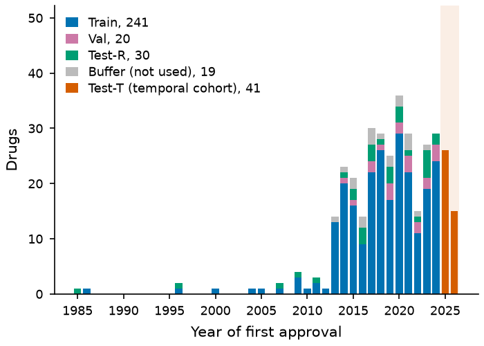
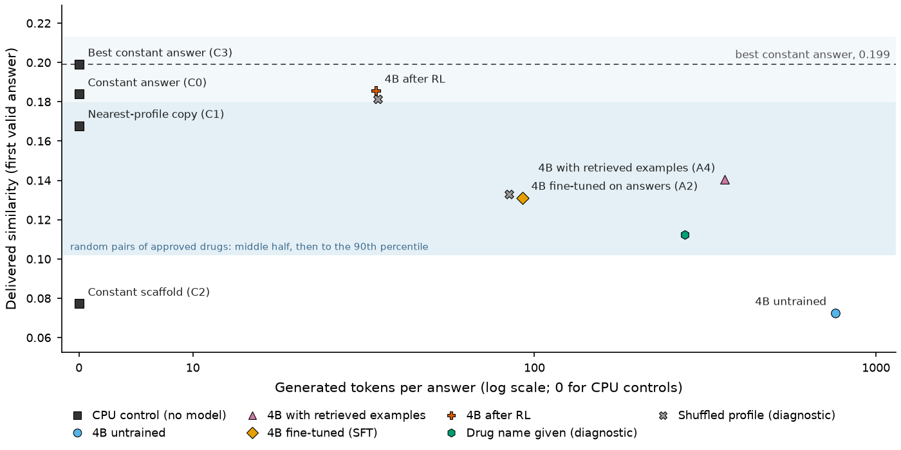
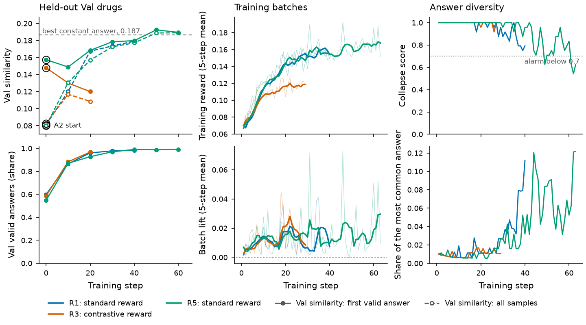

# Reinforcement learning did not beat a tuned constant answer at predicting the structures of newly approved drugs from their pharmacology profiles

*Controls for similarity-scored chemistry tasks: a pre-registered contrast on a temporal cohort of 2025-26 approvals, a constant-answer bar, a shuffled-profile counterfactual, a rank readout that one fixed answer cannot pass and a bounded reinforcement-learning case study.*

**Draft status, 2026-10-18.** A number is followed by an HTML comment naming the file that records it. The protocol was frozen by the git tag `prereg-v1` before any Test sample existed; the secondary analyses were registered by the addendum tagged `prereg-v1-a1` before any sample of a model arm was scored or read; the Test run is limited to the Qwen3.5-4B arms (the larger models are Val-only references). <!-- docs/prereg-v1.md; docs/prereg-v1-addendum1.md; git tags prereg-v1, prereg-v1-a1 -->

## Abstract

Fingerprint-similarity rewards are a cheap way to train language models that propose molecules, but a similarity score is easy to misread: an answer that ignores the input can earn most of it. We built a controls-first, pre-registered study of one task with a known answer, writing an approved drug's structure (SMILES) from a pharmacology profile with the name withheld (351 drugs split by structure component; a temporal cohort of 41 drugs first approved in 2025 and 2026; a random held-out split of 30). No system recovers a structure, and delivered similarities (0.07 to 0.20) lie between the 12th and 85th percentile of random pairs of approved drugs. A reward-optimal constant answer, chosen from training molecules and a public drug pool, delivers 0.199 on the temporal cohort, the best of 1,828 candidate constants there; the one pre-registered contrast, the validation-selected reinforcement-learning (RL) checkpoint of Qwen3.5-4B against it, does not reject (0.186; 10 wins and 31 losses over 41 drugs; p = 0.061). On random held-out drugs the constant ranks 21st and RL is ahead of it by 0.009 (p = 0.28, exploratory). RL beats the supervised and untrained models, but while converging on a generic structure: RL trained with the profile deleted reaches the same reward and validation similarity (0.178 and 0.196 in two runs against 0.195), and deleting the profile at test time costs the trained policy 0.018 of its 0.184 mean similarity, 60% of which another drug's profile recovers. A shuffled-profile counterfactual and a rank readout that one fixed answer cannot pass show a small profile-dependent signal on random held-out drugs and in larger untrained models (validation), and none we could detect on the temporal cohort; no Test profile test survives a multiplicity adjustment. We release the code, the splits and control answers and a ten-item checklist under open licences (the private profile texts are not included): report a tuned constant, a calibrated scale, the cost, a shuffled-input run and a constant-proof readout beside any similarity-rewarded result.

## Introduction

Language models are increasingly asked to propose molecules from text, and reinforcement learning with verifiable rewards is the fashionable way to improve them: a graded similarity between a generated structure and a reference supplies a cheap, automatic reward. We ask whether that recipe adds anything on a concrete task whose answer is known. The input is a written pharmacology profile of an approved drug with its name withheld; the output is the drug's structure as a SMILES string, scored against the registry structure.

The difficulty is not training; it is knowing what a score means. A similarity of 0.19 between Morgan count fingerprints sounds like partial success, but a generic drug-like molecule scores about that against any approved drug, so a reward that pays for similarity can be raised by answers that ignore the input. A study of this task therefore has to answer, before it reports any gain, what a zero-cost answer achieves, what a random pair of approved drugs scores, whether the model's answer depends on the drug at all, and what the score costs in samples and tokens.

We built the study controls-first and pre-registered it. One endpoint, the similarity of the first valid answer among eight samples at a stated cost, and one confirmatory contrast, the Val-selected RL checkpoint against the best of six tuned alternatives, are fixed by a git tag before any held-out sample exists. The alternatives include a reward-optimal constant answer chosen from the training molecules and a public drug pool, a copy of the nearest training profile's structure, untrained, retrieval-augmented and supervised fine-tuned models, and the held-out data include a temporal cohort of 41 drugs first approved in 2025 and 2026. Counterfactual and constant-proof readouts, a shuffled-profile run and a rank of the true drug among the split's own references, say whether a model uses the profile when the headline metric cannot.

We find four things. No system recovers a structure. The best system's delivered similarity is what one constant answer delivers: 0.186 for the RL checkpoint against 0.199 for the reward-optimal constant on the temporal cohort, a registered contrast that does not reject (p = 0.061). RL reached that level by converging on one generic structure, and RL trained without the profile reaches the same reward and the same validation similarity. And the profile carries a small drug-specific signal, visible on random held-out drugs and more clearly in the untrained 9B and 27B models, that we could not detect on the temporal cohort.

Our contributions are: (1) a protocol and a set of controls that can be applied to any similarity-scored text-to-structure result, released with the code and the split manifest; (2) the finding that on this task the fingerprint-similarity reward is raised by becoming generic, so that online RL reaches, and does not pass, the ceiling of a constant answer, while validity-only RL degrades to trivially valid answers; (3) a measurement of the small drug-specific signal that remains in the profile and of how little of it a trained 4B model keeps compared with copying the structure of the nearest training profile; and (4) a cost accounting of the whole study.

## 1. Task and data

**Question and task.** Does online reinforcement learning (RL) improve the recovery of held-out drug structures beyond cheaper alternatives, at matched inference cost? The input is a written pharmacology profile of an approved drug, name withheld. The output is its structure as a SMILES string (a one-line text code for a molecule), scored against the known structure. None of the 991 small-molecule prompts (980 once the 11 two-drug rows are set aside) contains the drug's name, and most state no computed property such as molecular weight or logP (75 to 93% mention none of the properties surveyed). <!-- docs/plan.md section 1 --> Success therefore mixes recall of the drug with reasoning from its profile.

**Data.** The private dataset has 1,146 rows, each a prompt, a reasoning trace and a final answer, in four prompt formats. <!-- data/processed/split_report.json --> The traces were written with the answer known, so they are explanations after the fact, not evidence that structures can be deduced. <!-- docs/memory/decision-task-framing.md --> We set aside 155 rows of a protein-related corpus (none has a small-molecule answer) and 11 two-drug combination rows, leaving 980 rows for 354 drugs. <!-- data/processed/split_report.json; the missing small-molecule answers come from an aggregate check of the raw files made for this draft --> A drug has one to six rows (its views, median three) sharing one answer. <!-- data/processed/refs.jsonl, rows per drug counted for this draft -->

**Reference structures.** The prompts hold no structure, so each drug name was matched to ChEMBL, cross-checked against the dataset's own answers, and resolved by hand where they disagreed or one was missing. For 942 of the 980 rows the name resolved; for 929 of them (98.6%) the dataset's answer has the registry structure's connectivity, and for 888 (94.3%) its full InChIKey including stereochemistry (89% as identical isomeric SMILES), so the answers are the real drugs. <!-- docs/plan.md section 1; docs/memory/decision-task-framing.md --> Three drugs were excluded: two products that are not single molecules and one single-atom product the answer reader cannot extract. <!-- data/processed/split_report.json (manual_effect, dropped); data/curated/manual_refs_notes.md; data/processed/refs.jsonl -->

**The temporal cohort.** Test-T holds the 41 drugs (100 rows) first approved in 2025 (26) or 2026 (15). Of 43 candidates with a first US approval in those years, an audit of the US, EU, UK, Japanese and Chinese regulators found earlier approvals for five, which left the cohort, and three cohort drugs outside the audit were dated by hand. <!-- data/curated/approval_audit.json; data/curated/approval_audit_notes.md; data/processed/refs.jsonl --> Approval is not disclosure, though: for 40 of the 41 drugs a PubChem record exists, created at least 3 years before approval in every case (median 10.5 years). <!-- data/processed/refs.jsonl, exposure fields, computed for this draft --> We therefore call Test-T a temporal cohort, not a set of unseen molecules, and record exposure covariates (PubChem record year, PubMed article count) for a tercile analysis.

**Splits.** Splits are by structure. Drugs join one component when their Tanimoto similarity (the share of substructure features two molecules have in common, from 0 to 1, here on 2,048-bit Morgan fingerprints) reaches 0.4 or they share an identical non-empty Murcko scaffold (the ring systems and the linkers between them); whole components go to one split. Test-T is assigned first and its components' other members (19 drugs) form an unused buffer; whole components then fill Test-R and Val by a seeded shuffle, and the rest is Train. The 351 usable drugs form 302 components, and no pair across splits reaches 0.4 or shares a scaffold (highest cross-split similarity 0.398). <!-- data/processed/split_report.json --> Test-T's drugs sit in 41 distinct components, so each is its own unit in the test of Section 3.

**Table 1.** Counts per split.

| Split | Drugs | Prompt rows | Components | First approval |
|---|---|---|---|---|
| Train | 241 | 687 | 218 | up to 2024 |
| Val | 20 | 58 | 16 | up to 2024 |
| Test-R (random components) | 30 | 80 | 27 | up to 2024 |
| Test-T (temporal cohort) | 41 | 100 | 41 | 2025 (26 drugs), 2026 (15) |
| Buffer (unused) | 19 | 49 | 8 | up to 2023 |
| Excluded | 3 | 6 | | |

<!-- Table 1: data/processed/split_report.json (drugs, rows, years); components per split counted from cluster ids in data/processed/refs.jsonl -->

**Figure 1.** Drugs by year of first approval, coloured by split (351 drugs; 3 excluded drugs are not shown). Test-T, the temporal cohort, is every drug first approved in 2025 to 2026 (41 drugs). The buffer holds drugs in the same similarity cluster as a Test-T drug and is not used.

## 2. Scoring

**Reading the answer.** A model reasons in a thinking block, then answers. The scorer reads only the text after the last closing tag, so an answer counts only if the block is closed (non-thinking runs supply an empty, closed block). From the end of that text it takes the last whitespace-separated piece that, with formatting characters stripped, is 8 to 1,500 characters long, contains a digit or a bond, branch, bracket or chirality character, and parses as a molecule in the RDKit chemistry toolkit. Answer and reference are reduced to their largest fragment and neutralised alike; over 400 atoms or any dummy atom makes an answer invalid. <!-- docs/contracts.md (Chemistry definitions) -->

**Identity.** Two structures are the same drug when they share the first block of the standard InChIKey (formula, connectivity and hydrogen placement, not stereochemistry). The key is strict because a looser one equated real isomers (delta-8 and delta-9 tetrahydrocannabinol) in review; five references carry a curated alternate spelling for registry differences in hydrogen placement. <!-- docs/memory/decision-connectivity-key.md --> Stereochemistry is compared by the full key and reported, never rewarded; the dataset's own answers match registry stereochemistry in only about 89% of rows. <!-- docs/plan.md section 1 -->

**Reward.** The reward is 0 for an answer that is missing, unparseable, from an unclosed thinking block or cut by the length limit, and 1.0 for an identity match. Otherwise it is 0.05 for a valid answer, plus 0.6 times the Tanimoto similarity to the reference, plus 0.3 if the Murcko scaffold equals the reference's non-empty scaffold. <!-- docs/contracts.md (reward.py v2) --> Similarity uses Morgan count fingerprints (radius 2, 2,048 positions), which penalise repeated units that a bit version ignores. <!-- docs/contracts.md --> The weights are provisional, tuned only on Train rollouts and Val. An earlier similarity floor of 0.2 erased the signal, since 98.5% of wrong drug pairs fall at or below 0.2 and group-relative RL learns from reward order within a group; a scaffold bonus replaced it (random drug pairs share a scaffold only 0.033% of the time, 20 of 61,425). <!-- docs/plan.md sections 0 and 1; docs/memory/decision-reward-v2.md -->

**Checks.** The answer reader was audited against a stricter rule ("the last line that is only a SMILES") on 10,304 Val samples from 29 runs: the two disagree on 2.1% of samples, only 0.05% as a different molecule. We kept the reader, because the RL arms were trained against it, and rescore the Test samples with the stricter rule as a sensitivity analysis (Section 5.3); a sample that hits the token limit fails for every arm. A second pre-set check failed: within a group of eight valid answers the reward ranks little (Section 5.5). Details are in Appendix B.

## 3. Metrics and statistics

**Unit.** The unit is the drug, not the row: a drug's value is the mean over its rows of the mean over each row's samples, and drugs count equally. <!-- docs/contracts.md (metrics.py) -->

**Confirmatory endpoint: first-valid similarity.** For each prompt row, draw up to eight answers and keep the first valid one (thinking block closed, molecule parses, sample not cut by the length limit). The row scores that answer's Tanimoto similarity to the true structure, or 0 if none qualifies; scores are averaged within drugs, then across drugs. This is the deployable policy "resample until the chemistry toolkit accepts the SMILES". It compares arms at matched validity without conditioning on it: expected similarity over all attempts mostly measures whether a model writes parseable SMILES, and a mean over valid answers only rewards failing on hard cases, which review rejected. Its cost is reported beside it: mean generations until the first valid answer (8 if none) and generated tokens per answer, retrieval and retries included (prompt tokens are not counted, which flatters the retrieval arm, whose prompt is longer). <!-- docs/contracts.md (metrics.py); docs/memory/decision-endpoint-fv-tanimoto.md --> The plan first named core recovery (an identity match or a shared non-empty scaffold). Val showed exact recovery at 0 and core recovery at most 5% for every arm, so a test on either would be decided by ties; after a second independent review we replaced it, using Val data only. <!-- docs/plan.md section 2; docs/memory/gotcha-core-endpoint-low-power.md; results/val_baselines.json -->

**Secondary metrics** (never primary; per sample, averaged as above). *Expected similarity*: Tanimoto over all attempts, invalid counting 0. *Validity*: share of samples valid, closed and finished. *Valid-only similarity*: mean over valid samples. *Exact recovery*: identity match. *Core recovery*: identity match or a shared non-empty scaffold. *Stereo-exact*: full-key match. *Majority vote* (maj@8): the most common structure among the first eight answers is the true one, ties earning nothing; deployable. *Pass@8*: at least one sample is a hit; picking it needs the answer, so it is an oracle upper bound. <!-- docs/contracts.md (metrics table) -->

**Profile-specific lift.** For a valid answer to drug d on a split, lift is its similarity to d's own reference minus its mean similarity to the other drugs' references; any other sample has lift 0. A constant answer valid on every row has lift exactly 0 over a complete panel. The zero holds only if completion (valid, closed, finished) does not depend on the drug; otherwise a fixed molecule can score above zero (+0.18 in a synthetic case where only one drug finishes). Lift measures association between the drug and everything the policy does, nuisance cues included, and depends on the drug panel: a diagnostic. <!-- docs/contracts.md (Lift, v3) -->

**Rank readout (registered in the addendum before any model sample was scored).** The endpoint is maximised by an answer that ignores the drug, so it cannot tell a system that reads the profile from one that learned a good generic molecule. For every prompt row we take the endpoint's own answer (the first valid, closed, finished one among eight samples), rank the split's N reference structures by Tanimoto similarity to it, and record where the row's own drug lands (ties share their mid-rank; a row with no valid answer takes the worst rank, and the share of rows with an answer is reported beside the result). Per drug we average over rows, then over drugs, and report the top-1 rate and the mean percentile rank (lower is better). One fixed answer that is valid on every row scores exactly 1/N on top-1 (at most that when its nearest references tie) and exactly (N+1)/2N on percentile rank, whatever molecule it is; failures and ties only lower it, and a drug-independent policy whose answers vary scores those values in expectation (sd 0.02 to 0.035 on Val), so the number of distinct answers is reported too. Contrasts use the same paired cluster sign-flip test as the endpoint. <!-- docs/prereg-v1-addendum1.md section 2; docs/contracts.md (rank_readout.py); scripts/rank_readout.py -->

**Random-pair calibration.** To place a similarity on the scale of the metric we computed the Tanimoto similarity of every pair of the 332 distinct reference structures of the four used splits (54,946 pairs; reference structures only): mean 0.141, median 0.141, 75th percentile 0.180, 90th 0.213, 99th 0.274. This is a scale over the study's drugs after a split rule that removes cross-split near neighbours, not a null distribution for a delivered similarity. <!-- results/random_pair_calibration.json; scripts/random_pair_calibration.py -->

**The confirmatory contrast (H1).** The Val-selected RL checkpoint (standard or contrastive reward) against the best comparator by Val first-valid similarity (the constant, copy-nearest, reward-optimal constant, untrained, retrieval or answer-only SFT arm, each at its Val-selected decoding), on Test-T. The test is an exact two-sided sign-flip permutation test on per-drug differences at level 0.05, with wins, losses and ties shown. Related drugs repeat one outcome, so differences are summed within each component and the component totals are sign-flipped (all patterns up to 20 non-tied units, else 100,000 random flips). <!-- docs/prereg-v1.md section 4 -->

Its null is that each component's summed difference is symmetric about zero, which is stronger than a zero mean, with independent components; it is not assumption-free. A studentized line (mean difference over its bootstrap standard error) and 95% percentile bootstrap intervals resampling whole components (10,000 resamples; 2,000 for Val tables) are descriptive only. <!-- docs/contracts.md; scripts/val_table.py --> All else is exploratory, without multiplicity adjustment, including H2 (a gain persists on Test-R, not only in the best-exposed third of Test-T) and H3 (baselines improve with size, identification most). Training seeds are few (Section 8). <!-- docs/paper/README.md --> The Test evaluation runs through a driver that refuses a specification whose hash differs from the one recorded at the freeze, a setting outside the frozen grid, and any split other than the two Test splits. <!-- gpu/final_eval.py; docs/prereg-v1.md section 6 -->

**Power and claims.** We made no formal power calculation. With n non-tied units the smallest two-sided p-value is 2 to the power 1 minus n: five non-tied drugs can never go below 0.0625 (five wins among 41 drugs with 36 ties give exactly that), and six that agree give 0.031. <!-- docs/contracts.md (the five-wins example); the general form is arithmetic from the test definition --> A metric on which most drugs tie, as exact and core recovery do, cannot be tested. For first-valid similarity, the standard deviation of the paired per-drug differences between arms on Val is 0.04 to 0.08 (20 drugs), so with 41 drugs a paired test at the 5% level and 80% power detects a difference of roughly 0.02 to 0.04 between arms (2.8 standard deviations over the square root of 41; the within-arm shuffle contrast of Section 5.4 has a smaller paired standard deviation and so a smaller minimum, 0.012 to 0.015); the Val gap between the selected RL checkpoint and the best constant is 0.008 (0.002 for the pilot), far inside that. Non-significance is not evidence of no effect. <!-- docs/plan.md section 2; consistency-pass computation from results/val_baselines.json inputs (paired per-drug SDs 0.040-0.083, MDD 0.017-0.036) -->

The allowed claim is "higher delivered similarity at a stated cost, against specified tuned controls, on this split and cohort". The protocol tied the word "profile" to three conditions at once: lift above zero with a bootstrap interval excluding zero, lift above the copy-nearest control, and a shuffled-profile run with lower first-valid similarity than the correct profile. The second condition asks whether an arm uses the profile better than TF-IDF retrieval, not whether it uses it, and the lift is biased for near-constant policies, so the addendum registered before any model sample was scored splits the word into two claims. **P1, "the arm's output depends on the profile"**, needs the matched shuffled-profile run to score lower on the same prompts (paired cluster sign-flip, alpha 0.05, on delivered similarity) and the same direction on the rank readout. **P2, "the arm uses the profile better than nearest-profile copying"**, needs P1 and a lift above the copy-nearest control's with a bootstrap interval for the difference excluding zero. P1 can be claimed only for the two arms with a shuffled-profile run (A2 and RL-full), and neither implies structure recovery. Not claimed: structure recovery (unless exact or core recovery also rise), novel-drug discovery, biological efficacy, general superiority or failure of RL, or molecules unseen in pretraining. <!-- docs/prereg-v1.md sections 1 and 7; docs/prereg-v1-addendum1.md section 3 -->

## 4. Arms and controls

Every arm is trained or tuned on Train only, selected on Val only, and scored once on Test after the freeze. <!-- docs/plan.md section 2 --> Labels: C0 to C3 (CPU controls), A0n (untrained, thinking off), A4 (retrieval), A2 and A1 (supervised fine-tuning, SFT, with LoRA low-rank adapters, on answers only and on reasoning traces), A3 (rejection-sampling fine-tuning, not run), A5 (online RL); untrained 9B and both 27B models are exploratory size references. A1 is a Val-only arm: its Test cost was not budgeted and its Val similarity cannot beat the best constant (protocol deviation D2). <!-- docs/prereg-v1.md sections 3 and 9 -->

**Models, prompts, decoding.** The size sweep uses `Qwen3.5-4B`, `Qwen3.5-9B`, `Qwen3.5-27B-FP8` and `Qwen3.8-27B-FP8`; the 27B models are official 8-bit floating-point checkpoints, and both are included to separate size from generation. <!-- docs/plan.md sections 0 and 1 --> The dataset's own system instruction asks for very high reasoning effort, and under it 99.8% of untrained 4B no-think samples hit a 512-token cap with no SMILES. <!-- results/colab_session1_report.json; docs/plan.md section 5 --> All answer-only arms therefore use the instruction "Reply with only the SMILES string of the drug described. No explanation." and an empty thinking block; trace SFT keeps the dataset's instruction. Sampling uses top-p 1.0 and at most 256 new tokens (8,192 for trace SFT). Each stochastic arm gets the same tuning: a temperature from 0.3, 0.6 and 1.0 is chosen on Val by first-valid similarity at eight samples and frozen, and Val-guided searches are capped at three settings per arm. <!-- docs/prereg-v1.md section 5 --> The chosen temperatures are 0.6 for the untrained 4B and for retrieval, 1.0 for A2 and 0.3 for the RL arm (replicate step 50); the untrained 9B uses its Val-best 0.6 and the 27B models, which were not tuned, 1.0. <!-- results/selection.json; results/frozen_arms.json -->

**CPU controls.** These are fixed by Train alone. C0 is the Train structure with the highest mean 2,048-bit Tanimoto similarity to the other Train structures, the do-nothing bar. C1 copies the structure of the Train drug whose profile text is most similar by word overlap (TF-IDF cosine); it is an answer copy, not retrieval-augmented prompting. C2 is the shortest Train structure among those with the most common scaffold. C3, the reward-optimal constant, is the single structure, taken from the Train references or from a public pool of approved drugs (every structure in or near a held-out split removed), with the highest mean Tanimoto similarity to the Train references (a Train candidate is scored without its own entry): what a policy that ignores the profile can at best learn. It maximises the similarity term of the reward; the reward also pays 0.05 for validity, which every constant earns, and 0.3 for a scaffold match, which random drug pairs satisfy 0.033% of the time, so the similarity-optimal constant is reward-optimal up to a negligible term. C0 to C3 are deterministic, so their first-valid similarity equals their mean similarity (each answer is repeated eight times to meet the endpoint's definition). C0 to C2 were scored on every split before the lock, as the protocol states, and C3 and the eight-sample copies were made after it from Train alone; no arm, decoding setting or comparator was chosen with a Test value, and the Test oracle ceilings quoted in the plan (0.30 and 0.28) come from reference structures only. <!-- docs/contracts.md (controls.py); scripts/best_constant.py; scripts/replicate_samples.py -->

**Class-information ceiling.** From ChEMBL release 37 we took 1,786 approved drugs in 771 components with coarsened class facts (ATC class, mechanism, target, indication), and predicted each drug's structure from the structures of its neighbours by two rules, the single nearest neighbour and the medoid of the nearest five, drawing neighbours only from other components as the real split requires. The one-neighbour rule scored 0.163 against 0.169 for the best constant (difference −0.006, bootstrap interval −0.011 to +0.001), and 0.174 against 0.188 for Train drugs alone (−0.014, −0.024 to −0.004); excluding only directly similar pairs instead makes it look useful (0.201, +0.032). <!-- results/class_ceiling.json --> So class facts, through these rules, do not beat a constant once whole components are held out. This does not bound learned predictors, richer facts or free-text profiles, and failing to reject zero is not equivalence: the copy-nearest control has positive lift (+0.022 on Val) at constant-level similarity. <!-- results/val_baselines.json --> <!-- docs/memory/decision-no-profile-scale-up.md (synthetic profiles to enlarge Train are deprioritised, not ruled out) -->

**Model arms at 4B.** Retrieval (A4) puts the three most similar Train profiles, never from the query's own component, in the prompt with their structures. Answer-only SFT (A2) trains rank-32 LoRA adapters on every decoder linear layer to write an empty thinking block and then the reference SMILES; epoch 1 had the lowest Val loss and is the arm. Trace SFT (A1) is Val-only (deviation D2) and rejection-sampling fine-tuning (A3) was not run. Details: Appendix C.

**Diagnostics, not arms.** Name-given replaces the profile by the drug's name, measuring recall for a model that knows which drug it is. Identification keeps the profile and asks for the name, scored by normalised name match; together they split the gap into identification (profile to name) and recall (name to structure). Shuffled-profile shows each row the profile of a donor row of another drug (same task type, same prompt-length tercile, another structural component whenever the stratum allows, found by an exact assignment), and scores against its own reference: an arm that uses the profile should lose first-valid similarity and lift there, and one that emits a good constant should not. The control keeps task type and length, not the section order or wording that differ between prompts of one task type. Blank-profile replaces the profile by "Drug: unknown." for every row, so the prompt is one fixed string and the eight draws are shared by all rows; it describes what the model says with no information about the drug and is read through mean similarity and validity, not through first-valid similarity. <!-- src/rlexp/arms.py; src/rlexp/ident.py; src/rlexp/shuffle.py; docs/memory/gotcha-blank-profile-shared-draws.md -->

**Online RL (A5).** We wrote a small training loop (REINFORCE with a group baseline, prompt-level aggregation, batch-normalised advantages, a 32-bit output head, no KL penalty) that starts from the A2 adapter and draws 24 distinct Train drugs and eight samples each per step (learning rate 2e-5, answers up to 128 tokens). The pilot R1 ran 40 steps, the replicate R5 (another seed) stopped itself at step 63 on a collapse rule, and the checkpoint entering the confirmatory contrast is the saved step with the highest Val delivered similarity when re-sampled with vLLM at eight samples and the arm's chosen temperature. Details: Appendix C.

**Reward modes and controls.** Standard is the reward of Section 2. Contrastive subtracts from a valid answer's reward 0.6 times its mean similarity to the other drugs' references in the same step, floored at zero, so a generic answer earns little and no answer scores below a failure. Validity-only gives 1 to a valid, closed, finished answer and 0 otherwise, isolating syntax. Profile-free RL replaces every profile by one fixed string under the same reward, and RL without the SFT start uses a fresh adapter. <!-- gpu/RL.md; src/rlexp/grpo.py -->

## 5. Results

### 5.1 The scale of the metric

Delivered similarity is a Tanimoto score between Morgan count vectors, and its scale is easy to misjudge. Over the 332 usable reference structures, two distinct approved drugs have a mean similarity of 0.141 (75th percentile 0.180, 90th 0.213, 99th 0.274; 54,946 pairs). A constant answer chosen from the training molecules (C0) delivers 0.176 on Val, the 73rd percentile of random pairs; the reward-optimal constant C3 delivers 0.187 (79th); the best constant that any candidate of our pool could have been on Val (the oracle constant, from reference structures only) is 0.195 (83rd); even an oracle that copies for each drug the nearest Train structure reaches only 0.31 (the 99.7th). Every arm in this study sits between the random-pair mean and the oracle constant: in the band where a constant answer lives. The level also moves with the split: the same C3 answer delivers 0.187 on Val, 0.199 on the temporal cohort and 0.159 on the random held-out split, and the best constant any candidate could have been is 0.195, 0.199 and 0.171, so differences between arms of less than about 0.02 are of the size that swapping 30 to 40 drugs does to a constant. <!-- computed from data/processed/refs.jsonl, reference structures only (scripts/random_pair_calibration.py); results/constant_ceiling.json; docs/plan.md section 5 for the nearest-Train oracle -->

### 5.2 The locked Test run: arms, cost and the constant

The Test run was made once, under the frozen specification: ten model runs (A0n, A4, A2 and RL-full, a shuffled-profile and a blank-profile run of A2 and of RL-full, and the name-given and identification probes of the untrained 4B) plus four CPU controls, both test splits, the larger models left as Val-only references (deviation D4). Both Val reproduction gates passed at the first attempt (A2 delivered 0.1557 against 0.1557 recorded at selection; the RL arm 0.1958 against 0.1949, which moved by +0.0009 with its fresh merge and vLLM batching; tolerance 0.005). The ten arms took 0.60 GPU-hours on one A100. Table 2 gives the temporal cohort (Test-T: 41 drugs, 100 prompt rows) and Table 3 the random held-out split (Test-R: 30 drugs, 80 rows); Figure 2 places every arm of Table 2 against the band of random pairs. <!-- results/test_t_baselines.json; results/test_r_baselines.json; results/compute_budget.json; results/figures/f2_similarity_vs_tokens_test_t.png -->

**Figure 2.** One point per run on the 41 Test-T drugs. Vertical: Tanimoto similarity to the true structure of the first valid answer among up to eight samples (0 if none is valid). Horizontal: tokens generated per answer, all samples drawn up to that answer; prompts are not counted and CPU controls generate none (plotted at 0). The dashed line is the best constant answer (C3, 0.199). Labels mark the best setting of each arm. 1 run has fewer than eight samples per prompt and no first-valid value, and is not shown. One training seed per arm; with 41 drugs, differences of a few hundredths are not resolved.

**Table 2.** Test-T, the temporal cohort (41 drugs, 41 components, first approved in 2025 and 2026). Delivered similarity is the endpoint with its cost; lift is the profile-specific association (a diagnostic, Section 3); the percentile places the similarity among the 54,946 pairs of reference structures (Section 3); the rank readout's chance values are exact for one fixed answer valid on every row, which the constants and the blank-profile runs are; "rows with an answer" is the share of rows that have a first-valid answer, which the percentile rank penalises as a failure; "distinct answers" is the number of different first-valid answers over the rows; tokens are generated tokens only. A blank-profile run has one shared first-valid answer, so its first-valid value is not shown (its mean similarity is).

| Arm | Decoding | Valid answers | Delivered similarity (95% interval) | Samples per answer | Tokens per answer | Delivered lift (95% interval) | Percentile among random pairs | Rank readout: top-1 / percentile rank (chance 0.024 / 0.512) | Rows with an answer | Distinct answers |
|---|---|---:|---:|---:|---:|---:|---:|---:|---:|---:|
| C0 constant answer (best Train reference) | none | 1.00 | 0.184 [0.169, 0.198] | 1.00 | 0 | -0.000 [-0.016, +0.014] | 77 | 0.024 / 0.512 | 1.00 | 1 |
| C1 copy of the nearest Train profile's structure | none | 1.00 | 0.168 [0.151, 0.184] | 1.00 | 0 | +0.014 [-0.000, +0.028] | 68 | 0.045 / 0.427 | 1.00 | 64 |
| C2 constant scaffold answer | none | 1.00 | 0.077 [0.067, 0.088] | 1.00 | 0 | +0.000 [-0.011, +0.011] | 14 | 0.024 / 0.512 | 1.00 | 1 |
| C3 reward-optimal constant (Train + public pool) | none | 1.00 | 0.199 [0.181, 0.216] | 1.00 | 0 | +0.000 [-0.018, +0.017] | 85 | 0.024 / 0.512 | 1.00 | 1 |
| A0n 4B untrained | T=0.6, no-think | 0.14 | 0.073 [0.053, 0.092] | 5.48 | 761 | +0.006 [-0.002, +0.014] | 12 | 0.027 / 0.697 | 0.55 | 54 |
| A4 4B + 3 retrieved examples | T=0.6, no-think | 0.53 | 0.140 [0.125, 0.155] | 2.40 | 360 | +0.013 [+0.003, +0.023] | 49 | 0.058 / 0.501 | 0.91 | 89 |
| A2 4B answer-only SFT | T=1.0, think mode | 0.51 | 0.131 [0.118, 0.144] | 2.00 | 92 | -0.004 [-0.016, +0.008] | 43 | 0.030 / 0.547 | 1.00 | 100 |
| RL-full 4B RL (Val-selected checkpoint, A5) | T=0.3, think mode | 0.99 | 0.186 [0.170, 0.201] | 1.00 | 34 | +0.009 [-0.007, +0.023] | 78 | 0.048 / 0.475 | 1.00 | 47 |
| A2, shuffled profile | T=1.0, think mode | 0.53 | 0.133 [0.120, 0.146] | 1.89 | 84 | +0.001 [-0.011, +0.012] | 45 | 0.037 / 0.503 | 1.00 | 100 |
| RL-full, shuffled profile | T=0.3, think mode | 0.99 | 0.181 [0.163, 0.198] | 1.00 | 35 | +0.005 [-0.012, +0.021] | 76 | 0.057 / 0.484 | 1.00 | 48 |
| A2, blank profile | T=1.0, think mode | 0.74 | mean similarity 0.117 | | | | 34 | 0.024 / 0.512 | 1.00 | 1 |
| RL-full, blank profile | T=0.3, think mode | 1.00 | mean similarity 0.166 | | | | 67 | 0.024 / 0.512 | 1.00 | 1 |
| 4B told the drug name (A0n prompt) | T=1.0, no-think | 0.22 | 0.112 [0.095, 0.130] | 3.58 | 275 | +0.003 [-0.007, +0.014] | 31 | n/a | n/a | n/a |

<!-- Table 2: results/test_t_baselines.json, results/rank_test_t.json, results/random_pair_percentiles_arms.json (scripts/final_table.py, scripts/rank_readout.py); C0 to C3 are deterministic and repeated to eight samples -->

**Table 3.** Test-R, random held-out components (30 drugs in 27 components; every comparison on it is exploratory).

| Arm | Decoding | Valid answers | Delivered similarity (95% interval) | Samples per answer | Tokens per answer | Delivered lift (95% interval) | Percentile among random pairs | Rank readout: top-1 / percentile rank (chance 0.033 / 0.517) | Rows with an answer | Distinct answers |
|---|---|---:|---:|---:|---:|---:|---:|---:|---:|---:|
| C0 constant answer (best Train reference) | none | 1.00 | 0.160 [0.134, 0.188] | 1.00 | 0 | +0.000 [-0.026, +0.030] | 62 | 0.033 / 0.517 | 1.00 | 1 |
| C1 copy of the nearest Train profile's structure | none | 1.00 | 0.166 [0.143, 0.187] | 1.00 | 0 | +0.038 [+0.015, +0.058] | 67 | 0.158 / 0.396 | 1.00 | 58 |
| C2 constant scaffold answer | none | 1.00 | 0.078 [0.064, 0.093] | 1.00 | 0 | -0.000 [-0.015, +0.016] | 14 | 0.033 / 0.517 | 1.00 | 1 |
| C3 reward-optimal constant (Train + public pool) | none | 1.00 | 0.159 [0.135, 0.187] | 1.00 | 0 | -0.000 [-0.025, +0.028] | 62 | 0.033 / 0.517 | 1.00 | 1 |
| A0n 4B untrained | T=0.6, no-think | 0.31 | 0.090 [0.071, 0.108] | 4.06 | 422 | +0.013 [+0.004, +0.023] | 19 | 0.086 / 0.582 | 0.71 | 51 |
| A4 4B + 3 retrieved examples | T=0.6, no-think | 0.57 | 0.138 [0.116, 0.156] | 2.15 | 291 | +0.024 [+0.006, +0.041] | 47 | 0.067 / 0.438 | 0.94 | 73 |
| A2 4B answer-only SFT | T=1.0, think mode | 0.52 | 0.133 [0.120, 0.150] | 2.12 | 98 | +0.017 [+0.004, +0.031] | 45 | 0.044 / 0.430 | 0.98 | 78 |
| RL-full 4B RL (Val-selected checkpoint, A5) | T=0.3, think mode | 0.98 | 0.168 [0.147, 0.193] | 1.02 | 34 | +0.013 [-0.008, +0.038] | 68 | 0.056 / 0.463 | 1.00 | 41 |
| A2, shuffled profile | T=1.0, think mode | 0.55 | 0.122 [0.107, 0.139] | 2.01 | 93 | +0.004 [-0.008, +0.016] | 38 | 0.053 / 0.517 | 0.99 | 78 |
| RL-full, shuffled profile | T=0.3, think mode | 0.98 | 0.156 [0.134, 0.180] | 1.02 | 33 | -0.000 [-0.022, +0.025] | 60 | 0.033 / 0.520 | 1.00 | 41 |
| A2, blank profile | T=1.0, think mode | 0.74 | mean similarity 0.102 | | | | 25 | 0.033 / 0.517 | 1.00 | 1 |
| RL-full, blank profile | T=0.3, think mode | 1.00 | mean similarity 0.153 | | | | 58 | 0.033 / 0.517 | 1.00 | 1 |
| 4B told the drug name (A0n prompt) | T=1.0, no-think | 0.28 | 0.099 [0.078, 0.120] | 3.66 | 286 | +0.008 [-0.006, +0.021] | 24 | n/a | n/a | n/a |

<!-- Table 3: results/test_r_baselines.json, results/rank_test_r.json -->

**No system recovers a structure.** Exact match is 0.000 for every arm on both splits and core match at most 0.001 for every model arm of Tables 2 and 3 (0.003 for the blank-profile A2 run on Test-T), so, as on Val, arms are separated by similarity and not by recovery. Delivered similarities lie between the 12th percentile of random pairs (the untrained 4B, 0.073) and the 85th (C3, 0.199). The scale also moves with the split: the same C3 answer delivers 0.199 on Test-T and 0.159 on Test-R, and C3 is the best of the 1,828 candidate constants on Test-T (the oracle constant is 0.199) but 21st on Test-R (oracle 0.171). <!-- results/constant_ceiling_test.json -->

**Deleting the profile costs a tenth of the score, and a part of that is not drug-specific.** A blank-profile run shows every row the same prompt, so its first-valid value is one shared molecule and only its mean similarity is read. For the RL checkpoint the mean similarity over all samples is 0.184 on the real profile and 0.166 with the profile deleted on Test-T (difference +0.018, 95% interval +0.009 to +0.027; 32 wins and 9 losses over the drugs; p = 0.0001) and 0.166 against 0.153 on Test-R (+0.013, +0.003 to +0.023; p = 0.023), at unchanged validity (0.99 and 1.00): about 90% of the delivered score survives deleting the whole input. Showing another drug's profile instead recovers part of the loss: on Test-T the shuffled-profile run scores 0.177, so about 0.011 of the 0.018 is the cost of an unfamiliar prompt and 0.007 is drug-specific (real minus shuffled on mean similarity +0.007, +0.000 to +0.014, p = 0.050; the registered contrast on delivered similarity is +0.004, p = 0.31); on Test-R nearly all of it is drug-specific (real minus shuffled +0.012, p = 0.016). For A2 the comparison is not clean, because its blank prompt raises validity (0.51 to 0.74) and with it the mean similarity (0.071 to 0.117). <!-- results/paired_blank_test_t.json; results/paired_blank_test_r.json; results/paired_test_t.json and paired_test_r.json (mean_tanimoto of RL-full against RL-full-shuffle) -->

### 5.3 The registered contrast, and what RL bought

**The confirmatory contrast does not reject.** The Val-selected RL checkpoint delivers 0.186 on the 41 temporal-cohort drugs against 0.199 for the reward-optimal constant C3, the registered comparator: difference -0.013 (95% bootstrap interval -0.026 to +0.0004), RL ahead on 10 drugs and behind on 31, cluster sign-flip p = 0.061 (Monte Carlo, 100,000 flips, alpha 0.05, two-sided). The claim "higher delivered similarity than the best comparator" is not supported, and the point estimate points the other way. The reading does not depend on the answer reader: under the strict reader the confirmatory pair is unchanged (RL-full is identical to seven decimals; the strict rescoring moves only A2 slightly: valid share 0.513 to 0.508, expected similarity 0.0709 to 0.0700, the shuffle contrast -0.0019 to -0.0012). An independent recomputation from the scored files (numpy only) reproduces the difference, the 10 wins and 31 losses and the interval, with p = 0.0595 at 400,000 flips. The expected similarity over all samples, which is not the endpoint, shows the same direction with a smaller p (difference -0.015, p = 0.029; secondary and unadjusted). On Test-R, an exploratory comparison, RL is ahead of C3 by 0.009 (0.168 against 0.159; 21 wins, 9 losses, p = 0.28). <!-- results/confirmatory.json (paired.test_t, paired.test_r); results/paired_strict_test_t.json; results/confirmatory_recompute.json -->

The contrast could not have detected a difference of the size observed: at 41 drugs the minimum detectable difference is about 0.02 to 0.04 (Section 3) against an observed -0.013, and a non-rejection is not equivalence. The result does not need the p-value to carry weight: on the temporal cohort the reward-optimal constant is the best of the 1,828 candidate constants (oracle 0.199), so no constant, and no policy that ignores the drug, could have done better there, and the trained policy ended below it.

**What RL bought, and what it cost.** Against the other model arms RL is far ahead on Test-T: +0.054 over its own starting point A2 (37 wins, 4 losses), +0.045 over retrieval A4 (32, 9) and +0.113 over the untrained model (40, 1), each p < 0.001, and it is also the cheapest model arm: one sample and 34 tokens per answer against 2.0 and 92 for A2, 2.4 and 360 for A4 and 5.5 and 761 for the untrained model; 99% of its samples are valid against 51%, 53% and 14%. Against the arms that cost nothing it is not ahead: +0.002 over C0, the Train-only constant (24 wins, 17 losses, p = 0.78), +0.018 over the nearest-profile copy C1 (30, 11; p = 0.028) and -0.013 against C3. The same ordering holds on Test-R (RL ahead of A2, A4 and the untrained model with p between 0.00001 and 0.007, and of the constants by 0.003 to 0.009, p above 0.27). So what RL did on this task was to bring a model that answered validly half of the time to the level of a Train-only constant, at the cost of 0.8 to 1.5 GPU-hours per run (Section 9). <!-- results/paired_test_t.json; results/paired_test_r.json -->

**Selection optimism.** The checkpoint reached 0.195 on Val, the best of 21 candidates on those 20 drugs. On held-out drugs it delivers 0.186 and 0.168 while the constant C3 delivers 0.199 and 0.159: a Val margin of +0.008 over C3 became -0.013 and +0.009, a margin that changes sign between splits and is not distinguishable from zero in either.

### 5.4 Does any arm use the profile?

**Validation drugs.** Showing each row the profile of another drug lowers A2's delivered similarity from 0.156 to 0.131 (paired sign-flip p 0.022; 13 wins and 7 losses over the 20 drugs) and the selected RL checkpoint's from 0.195 to 0.183 (+0.012 for the real profile, interval [0.003, 0.020]; 13 wins and 7 losses; p 0.034); the mean similarity over all samples falls from 0.193 to 0.181 (p 0.0095). A blank profile (one fixed prompt, so the eight draws are shared by every row, and only the similarity of its valid answers, 0.182, is read, never its first-valid value) leaves the RL checkpoint at the same level as the shuffled profile. The profile therefore carries a small drug-specific signal, about 0.01 to 0.02 Tanimoto, as the copy-nearest control (lift +0.022) also indicates, and it is dwarfed by the 0.19 that a well-chosen constant delivers. Lift, the profile-specific association of Section 3, is a diagnostic only: it is biased for near-constant policies.

The rank readout (Section 3) is the check that a constant cannot pass. On Val (20 drugs; chance 0.050 on top-1 and 0.525 on mean percentile rank) both constants and the blank-profile RL run score exactly chance, as they must. The nearest-profile copy scores 0.129 and 0.439, retrieval (A4) 0.150 and 0.464, answer-only SFT 0.188 and 0.396, the selected RL checkpoint 0.100 and 0.473, the untrained 9B 0.113 and 0.424 and the untrained 27B 0.196 and 0.379; the untrained 4B, which fails on a third of the rows, scores worse than chance (0.623). Showing another drug's profile moves the percentile rank of A2 from 0.396 to 0.566 (16 wins and 4 losses over the drugs, p = 0.0045) and of the RL checkpoint from 0.473 to 0.528 (12, 6 and 2 ties; p = 0.027); with the delivered-similarity contrasts these are the registered secondary hypotheses S1 and S2 (Table 4). Two cautions from the independent review of the readout. The shuffled-profile contrast tests dependence on the profile but is not an effect size, because a shuffled answer follows its donor drug, which is itself a candidate: A2 on a shuffled profile ranks the true drug below chance (0.566). And the apparent advantage of A2 over RL (0.396 against 0.473, p = 0.17; registered as S3) is partly decoding: A2 sampled at T=0.3 and T=0.6 scores 0.498 and 0.508, behind RL's 0.473, so S3 compares two deployed policies, not an RL step. <!-- results/rank_val.json; results/paired_val_profile.json; docs/plan.md section 0 (review log) -->

**Locked Test run.** Table 4 gives the registered contrasts: each arm on its real profile against its own shuffled-profile run, on delivered similarity and on the rank readout, with Val (the selection data) beside the two Test splits. On Test-T neither arm meets the P1 criterion of the addendum: RL on the real profile delivers 0.186 against 0.181 shuffled (+0.004, p = 0.31) and ranks the true drug at 0.475 against 0.484 (p = 0.59); A2 delivers 0.131 against 0.133 (p = 0.78) and ranks it at 0.547 against 0.503, worse than its shuffled run (p = 0.27). On Test-R, exploratory, RL delivers 0.168 against 0.156 (+0.013, 20 wins and 10 losses, p = 0.010) and ranks at 0.463 against 0.520 (p = 0.084), so it meets P1 there (exploratory; the readout's own p-value is 0.084); A2 does not (p = 0.30 and 0.065). The Val effects (+0.012 and +0.024) are therefore of the size seen on Test-R and absent on the cohort of drugs first approved in 2025 and 2026. P2 is not met by any arm (the comparison with the nearest-profile copy follows). Four secondary hypotheses with two measures each are unadjusted, so a single p near 0.01 to 0.05 is suggestive at most: Holm's adjustment over the eight Test cells of Table 4 turns the smallest p (RL on Test-R, 0.010) into 0.080, so no Test cell survives adjustment. <!-- results/paired_test_t.json; results/paired_test_r.json; results/rank_test_t.json; results/rank_test_r.json; results/rank_val.json -->

**Table 4.** Real against shuffled profile (S1 and S2 of the addendum), with Val (the selection data) beside the two Test splits. "Percentile rank" is the rank readout (lower is better; chance 0.525 on Val, 0.512 on Test-T, 0.517 on Test-R). Differences are real minus shuffled; for the percentile rank a negative difference favours the real profile. Wins, losses and ties count drugs; the p-values are paired cluster sign-flip tests.

| Split | Arm | Delivered similarity, real / shuffled | Difference [95% interval] | W / L / T | p | Percentile rank, real / shuffled | Difference | W / L / T | p |
|---|---|---|---|---|---|---|---|---|---|
| Val | A2 | 0.156 / 0.131 | +0.024 [+0.007, +0.046] | 13 / 7 / 0 | 0.022 | 0.396 / 0.566 | -0.170 | 16 / 4 / 0 | 0.005 |
| Val | RL-full | 0.195 / 0.183 | +0.012 [+0.003, +0.020] | 13 / 7 / 0 | 0.034 | 0.473 / 0.528 | -0.055 | 12 / 6 / 2 | 0.027 |
| Test-T | A2 | 0.131 / 0.133 | -0.002 [-0.015, +0.012] | 21 / 20 / 0 | 0.783 | 0.547 / 0.503 | +0.043 | 24 / 17 / 0 | 0.265 |
| Test-T | RL-full | 0.186 / 0.181 | +0.004 [-0.003, +0.013] | 18 / 22 / 1 | 0.312 | 0.475 / 0.484 | -0.010 | 18 / 19 / 4 | 0.588 |
| Test-R | A2 | 0.133 / 0.122 | +0.011 [-0.007, +0.030] | 18 / 12 / 0 | 0.302 | 0.430 / 0.517 | -0.087 | 19 / 10 / 1 | 0.065 |
| Test-R | RL-full | 0.168 / 0.156 | +0.013 [+0.004, +0.022] | 20 / 10 / 0 | 0.010 | 0.463 / 0.520 | -0.057 | 16 / 10 / 4 | 0.084 |

<!-- Table 4: results/paired_val_profile.json, results/paired_test_t.json, results/paired_test_r.json, results/rank_val.json, results/rank_test_t.json, results/rank_test_r.json -->

**Split by split.** Three splits, two arms and two measures give twelve cells (Table 4). The profile dependence is detected, at p < 0.05 and in the same direction on both measures, for A2 and RL on Val, and for RL on Test-R on delivered similarity (the readout's own p there is 0.084). It is not detected for either arm on Test-T, nor for A2 on Test-R on delivered similarity. On Test-T the registered P1 criterion is therefore met by neither arm, and we do not read that as showing the signal is absent. The two held-out splits did not give the same answer, but the difference between their effects is not established on delivered similarity (RL: +0.004 on Test-T against +0.013 on Test-R, difference -0.009, 95% interval -0.021 to +0.004; A2: -0.002 against +0.011, difference -0.013, interval -0.036 to +0.010; exploratory component bootstrap). On the readout it is established for A2, but in an odd way: A2 ranks the true drug worse than chance on Test-T (0.547 against 0.512, with every row answered and 100 distinct answers), and this is stable and not noise: over 300 random 30-drug candidate subsets A2 real minus shuffled is +0.043 (+0.031 to +0.054, a spread over candidates only, not over drugs). A reading consistent with Val is that an answer shaped by a similar-looking profile lands near another candidate, which is likelier in the most crowded candidate set (below); we did not test it. Power does not explain the delivered-similarity result: Test-T is the more precise split (minimum detectable difference of the shuffle contrast for RL 0.012 over 41 units against 0.015 over 27), and its observed effect is a third of Test-R's. <!-- results/exploratory_cohort_diagnostics.json (heterogeneity); scripts/cohort_diagnostics.py -->

**How the two held-out splits differ.** Read-only, exploratory comparisons (medians; permutation tests over rows or drugs) show that the temporal cohort differs from Test-R in several ways at once: its prompts are longer (790 against 594 tokens per row, p = 0.001), its PubChem records are later (median 2014.5 against 2006, p = 0.003) and it has far fewer PubMed articles (67 against 355, p = 0.0001). Its reference structures are more crowded (68% of its drugs have another reference above 0.25 similarity, against 40% on Test-R and 30% on Val), and the headroom of a policy that could pick the best Train structure for each drug over the constant C3 is smaller (median 0.086 against 0.124 on Test-R and 0.120 on Val), although its nearest-Train similarity is the same (0.291 against 0.288, p = 0.77) and its structures are not measurably larger (median 34 heavy atoms against 31, p = 0.13). Recomputing the Test-T readout on random 30-drug candidate subsets, the size of Test-R, leaves it unchanged (RL real minus shuffled -0.010, A2 +0.043), so the size of the candidate set does not explain it. What the data allow is that the two splits differ in several measurable ways and this study cannot say which matters. <!-- results/exploratory_cohort_diagnostics.json (headroom, crowding, subset_readout, composition) -->

**Nearest-profile copy and the trained arms.** The copy of the structure of the nearest training profile (C1, no model) has the best point estimate on the rank readout of every arm on both Test splits (percentile rank 0.427 on Test-T, 0.396 on Test-R). It is significantly better than A2 on Test-T (-0.120, p = 0.007) and not significantly different from RL (-0.048, p = 0.27 on Test-T; -0.067, p = 0.27 on Test-R) or from A4 (p = 0.09 and 0.31); on Val, A2 and the untrained 27B ranked the true drug better than C1 did (0.396 and 0.379 against 0.439; p = 0.41 and 0.66). On delivered lift RL is not distinguishable from C1 either (RL minus C1 -0.006 [-0.021, +0.009] on Test-T and -0.024 [-0.052, +0.004] on Test-R), and the only arm whose lift interval excludes zero on Test-T is retrieval A4 (+0.013 [+0.003, +0.023]; C1 +0.014 [-0.000, +0.028]). So no trained 4B arm is shown to carry more drug-specific information than TF-IDF retrieval over the 241 training profiles, and the arm that reads the profile best by lift is the one that retrieves. Whether RL changes the dependence on the profile is not settled either: on Test-T RL's lift exceeds A2's (+0.012 [+0.002, +0.023], p = 0.031) and its readout is better (S3, p = 0.024), on Val and Test-R the order is the other way or null, and the two arms are sampled at different temperatures. <!-- results/rank_c1_contrasts_test_t.json; results/rank_c1_contrasts_test_r.json; results/rank_c1_contrasts_val.json; results/paired_test_t.json (fv_lift) -->

**The larger models (Val only).** The matched shuffled-profile runs of the untrained larger models, made after the tag as Val-only mechanism controls (addendum, section 6), show a larger dependence on the profile than the 4B arms do. The untrained 9B delivers 0.166 on the real profile against 0.126 shuffled (+0.040; 15 wins and 5 losses over the drugs; p = 0.045) and ranks the true drug at 0.424 against 0.598 (p = 0.033); the untrained 27B delivers 0.186 against 0.138 (+0.049; 15 and 5; p = 0.009) and ranks it at 0.379 against 0.561 (p = 0.048). Both meet the P1 criterion on Val (exploratory, unadjusted, 20 drugs). The delivered similarity of the real-profile 27B (0.186) is still the constant's (0.187), and it is not shown to use the profile better than nearest-profile copying: its lift exceeds C1's by 0.023 (interval -0.021 to +0.066), so P2 is not met. Across the three Val pairs ordered by size the shuffle costs 0.024 (A2, 4B), 0.040 (9B) and 0.049 (27B), but these are different training regimes and prompts and not a controlled sweep. <!-- results/paired_val_size_shuffle.json; results/rank_val_size_shuffle.json; results/paired_val_size_vs_controls.json --> <!-- results/val_baselines.json (a2-shuffle-t1.0, r5s50-shuffle-t0.3, r5s50-blank-t0.3); paired reports in runs/colab-s1 -->

### 5.5 Why RL ends at the constant: a case study

RL started from A2 (56% valid, delivered similarity 0.156). In the pilot run (R1: 24 drugs per step, eight samples each, 40 steps) the answers became valid within 20 steps (98%) and the delivered similarity at steps 10, 20, 30 and 40 rose to 0.163, 0.175, 0.178 and 0.186 at T=0.3 (0.150, 0.168, 0.180 and 0.189 at T=0.6; Figure 3). Because that curve was still rising, a replicate with another seed (R5, a budget of 100 steps) was added before any Test sample. It followed the same path to step 40 (0.183 at T=0.3 and T=0.6, 0.187 at T=1.0), reached its best at step 50 (0.195 at T=0.3, 0.193 at T=0.6) and held it at step 60 (0.193), then stopped itself at step 63 on its collapse rule. The Val-selected checkpoint is therefore R5 step 50 at T=0.3, with delivered similarity 0.195 against 0.187 for the best constant C3 and 0.195 for the best constant that any candidate of our pool could have been on Val (the oracle constant). <!-- results/val_baselines.json (rlfull5-* rows); results/selection.json; results/constant_ceiling.json; runs/rl/R5/summary.json (status stopped_collapse, step 63) -->

**Figure 3.** RL pilot runs (R1, R5, R2, R3). Left: Val similarity as the similarity of the first valid answer (solid line; only runs that sampled eight per prompt log it) and as the mean over all samples with invalid answers counted as 0 (dashed line), and the share of valid answers, every 10 steps; circled points are the A2 checkpoint RL starts from, the dashed grey line is the best constant answer. Middle: training reward (the standard reward, also for runs trained on another reward) and batch lift, trailing 5-step mean (faint lines: single steps). Right: collapse score (distinct most-common answers over drugs with a valid answer; alarm below 0.7) and the share of valid answers equal to the most common one.

The gain is not knowledge of the drug. Lift stays near zero (R5 step 50: fv_lift 0.013, interval [-0.012, 0.044]) and the answers converge: the mean similarity between the answers given to different drugs rises from 0.13 (A2) to 0.46 (pilot, step 40) and 0.51 (R5 step 50), the most common structure grows from 0.4% to 14% and 20% of the usable answers, and the mean similarity of the answers to the C3 constant rises from 0.17 to 0.27 and 0.30 (Table 5). No answer is the C3 molecule itself. RL learned to write a valid, generic structure close to the one that is best for the reward, which is what a constant does; when it collapsed further (R5 step 63: a single structure in 12% of a training batch, collapse score 0.54 to 0.62), the Val gain stopped. <!-- results/answer_diversity.json; results/figures/f3_rl_training.png -->

**Table 5.** How concentrated the usable answers are (valid, closed, finished answers pooled over the eight samples of every prompt; aggregates only), on Val and on Test-T.

| Run | Usable answers | Distinct structures | Share of the most common structure | Mean similarity to the C3 answer | Mean similarity between answers to different drugs |
|---|---:|---:|---:|---:|---:|
| A2 (T=1.0) | 256 | 256 | 0.004 | 0.167 | 0.130 |
| A4 (T=1.0) | 205 | 187 | 0.039 | 0.159 | 0.132 |
| Untrained 9B (T=0.6) | 288 | 287 | 0.007 | 0.212 | 0.192 |
| Untrained 27B (T=1.0) | 302 | 298 | 0.010 | 0.185 | 0.150 |
| RL-full pilot, step 20 (T=0.6) | 457 | 335 | 0.048 | 0.246 | 0.297 |
| RL-full pilot, step 40 (T=0.6) | 454 | 132 | 0.141 | 0.265 | 0.461 |
| RL-full replicate, step 50 (T=0.3), the Val-selected checkpoint | 464 | 82 | 0.200 | 0.296 | 0.512 |
| RL-full replicate, step 60 (T=0.3) | 464 | 121 | 0.134 | 0.307 | 0.571 |
| RL-contrastive step 10 (T=0.6) | 446 | 408 | 0.027 | 0.150 | 0.143 |
| A2 (T=1.0) on Test-T | 418 | 415 | 0.007 | 0.166 | 0.135 |
| A4 (T=0.6) on Test-T | 413 | 341 | 0.031 | 0.180 | 0.141 |
| RL-full, the Val-selected checkpoint (T=0.3) on Test-T | 788 | 183 | 0.188 | 0.298 | 0.475 |

<!-- Table 5: results/answer_diversity.json (Val), results/answer_diversity_test_t.json (scripts/answer_diversity.py) -->

**Where the RL answers went.** On Test-T the 788 usable RL answers use 183 distinct structures, the most common is 18.8% of them, the mean similarity between answers given to two different drugs is 0.475 (A2: 0.135, A4: 0.141, untrained: 0.125) and the mean similarity to the C3 molecule is 0.298; no answer is the C3 molecule itself. Test-R shows the same (140 distinct structures among 628 usable answers, the most common 15.8%, between-drug similarity 0.422, similarity to C3 0.288). This is the Val finding above on held-out drugs: the policy RL found is generic. <!-- results/answer_diversity_test_t.json; results/answer_diversity_test_r.json -->

Two further runs show what shapes this outcome. Validity-only RL (R2: the R1 recipe with reward 1 for a valid, closed, finished answer and 0 otherwise) reaches 99% valid answers by step 30, but its delivered similarity falls from 0.148 (the A2 start, in-training evaluation at T=1.0) to 0.078 at step 40 (0.074 to 0.080 when the step-40 adapter is re-sampled with vLLM at the three grid temperatures): the answers become short, trivially valid structures (17 tokens against 39, valid-answer similarity 0.078 against 0.142), the reverse of the generic structure that the similarity reward selects. The contrastive reward, which pays only for similarity beyond what an answer would score against the other drugs' references, did worse: 0.113 to 0.123 at steps 10 and 20, below its A2 start; its run was cut short by the loss of the compute runtime at about step 28 of 40, so no later checkpoint exists. <!-- runs/rl/R2/evals.jsonl, summary.json (status complete, 40 steps); results/val_baselines.json (rlvalidity-* and r3s* rows) -->

**Profile-free RL.** To test whether the reward gain needs the profile at all, we repeated the pilot recipe with every profile replaced by one fixed string (R4, seed 0, and R4b, seed 1, the seed of R5: the same A2 start, 24 drugs and eight samples per step, learning rate 2e-5, 40 steps; trained and evaluated without the profile; Val only). Their training reward follows the run with the profile (mean of steps 31 to 40: 0.159 and 0.152 against 0.158 for R5), and their Val delivered similarity in the in-training evaluation reaches 0.181 and 0.194 at step 40, against 0.180 for the run with the profile at step 40 and 0.192 at step 50. Re-sampled with vLLM at T=0.3 and shown the real profile, the two merged step-40 checkpoints deliver 0.178 and 0.196, against 0.183 for R5 at step 40, 0.195 for its selected checkpoint (the best of 21 candidates) and 0.187 for the constant C3; with a blank profile their mean similarity is 0.181 and 0.191 (R5's selected checkpoint: 0.182). So the reward gain RL reached does not need the profile: in two of two runs the similarity reward was satisfied, to the level reached with the profile, by policies that never saw a profile in training. The two policies kept different amounts of A2's profile dependence. Shown a shuffled profile, the seed-0 policy loses 0.001 (3 wins, 1 loss, 16 ties; p = 1.0) and the seed-1 policy 0.011 (8, 3, 9; p = 0.027; rank readout 0.490 against 0.553, p = 0.078), against 0.012 for the profile-trained checkpoint, so the profile dependence of the RL checkpoint is not larger than what RL runs that never saw a profile retain from the SFT start. Both runs concentrate on few answers: over steps 31 to 40 the most common answer is 99% and 81% of a training batch, and 94% and 42% of groups have no reward variance. <!-- runs/rl/R4/evals.jsonl, runs/rl/R4b/evals.jsonl, metrics.jsonl; results/paired_val_r4.json; results/paired_val_r4b.json; results/paired_val_r4_vs_r5s40.json; results/rank_val_r4.json; results/rank_val_r4b.json -->

The reward structure explains why. Within a group of eight valid answers the reward ranks almost nothing: the share of prompts whose valid answers have a reward standard deviation of at least 0.05 never exceeds 15.5% for any run (5.2% for A2 at T=1.0, 0 to 5% for the RL checkpoints against the 30% the protocol asked for), so the advantage a group-relative method can use lies between valid and invalid answers and between generic and unusual structures, not between a drug's right and wrong neighbours. <!-- results/t5.json -->

### 5.6 Probes and exposure

**Probes.** Told the drug's name, the untrained 4B delivers 0.112 on Test-T (0.099 on Test-R), below the constant, with exact match 0; asked to name the drug from its profile it matches the name in none of its Test-T samples and in 2.7% of its Test-R samples. At 4B the limit is therefore recall of structure from a name as much as identifying the drug. <!-- results/test_t_baselines.json (name-4B, ident-4B rows); results/test_r_baselines.json -->

**Exposure.** Splitting Test-T into terciles of PubMed article count (14, 14 and 13 drugs) and of the years the structure was public before approval (14, 13 and 13 of the 40 drugs with a PubChem record; exploratory, no adjustment), RL minus C3 is negative in all three PubMed terciles (-0.008, p = 0.61; -0.029, p = 0.007; -0.002, p = 0.86) and in the two lower terciles of years public (-0.024, p = 0.0007; -0.036, p = 0.001), and positive in the highest (+0.019, p = 0.26). The level of C3 itself swings across those terciles (0.202, 0.222, 0.182), so the pattern is partly the constant's; with six tests and 13 drugs per tercile we draw no conclusion. <!-- results/exposure_test_t.json -->

## 6. Discussion

**What the study shows.** Four results carry the paper, and none depends on a p-value near 0.05. (1) No system recovers a structure: exact match is 0 for every arm on every split. (2) On the temporal cohort the reward-optimal constant is the best of 1,828 candidate constants (0.199) and the trained policy ended below it (0.186). (3) The policy's answers collapsed onto a few structures: 47 distinct first-valid answers over 100 rows, one structure in 19% of its usable answers, and a similarity of 0.475 between answers to different drugs against 0.135 before RL. (4) The reward gain does not need the profile: two RL runs trained with the profile deleted follow the same training reward and end at 0.178 and 0.196 on Val against 0.183 at the same step with the profile (0.195 for the selected checkpoint), and deleting the profile at test time costs the trained policy a tenth of its mean similarity (0.018, interval 0.009 to 0.027 on Test-T), 60% of which showing another drug's profile recovers. The registered contrast, which did not reject (0.186 against 0.199, p = 0.061), is a check on these and not their support: we could not have detected a difference of its size, and a non-rejection is not equivalence. What RL did achieve is real but is a comparison among language models: +0.054 over the supervised model it started from and +0.113 over the untrained model, at 34 tokens per answer against 92 and 761, while the same 0.19 to 0.20 is available for free by answering one fixed molecule.

**Why RL stopped where it did.** The reward pays for similarity, and a drug-independent answer captures almost all of what is available: the best constant any candidate could have been is 0.195 on Val and 0.199 on Test-T. Within a group of eight valid answers the reward ranks little (Section 5.5), so the advantage a group-relative method can use lies between valid and invalid answers and between generic and unusual structures; the policy moved to a generic structure and, once there, stopped improving. A validity-only reward moved the other way, to short, trivially valid answers (0.078 on Val), and the profile-free runs show that the generic structure is reachable with no input. We observed the convergence and ran that control; we did not test the mechanism further (for example with a reward constructed to have no generic optimum), and "learned a generic structure" describes what the policy did, not why.

**What the profile contains.** A small, drug-specific signal exists. Replacing the profile with another drug's lowers delivered similarity by 0.012 for RL and 0.024 for A2 on Val, by 0.040 and 0.049 for the untrained 9B and 27B on Val, and by 0.013 for RL on random held-out drugs (p = 0.010, which does not survive an adjustment over the eight Test cells); no arm shows it on the temporal cohort (+0.004 and -0.002), although the difference between the two held-out splits is not itself established for delivered similarity (Section 5.4). On Val there is no sign that RL added it: RL runs that never saw a profile retain as much of it from the SFT start (+0.001 and +0.011) as the profile-trained checkpoint shows (+0.012), and all are below A2's +0.024; on Test-T, though, RL's lift exceeds A2's and its readout is better, so whether RL changes the dependence on the profile is not settled. A copy of the structure of the nearest training profile is as good as any trained 4B arm on the rank readout, and retrieval is the one arm whose lift excludes zero on the temporal cohort; the untrained 27B depends on the profile most and ranks the true drug best on Val (0.379), yet delivers only the constant's 0.186. These are small effects on small samples with no multiplicity adjustment, and the temporal cohort differs from the random split in several measurable ways at once, so we do not claim the signal disappears for new drugs, only that this study could not detect it.

**What practitioners should do differently.** First, compute the reward-optimal constant on the training set (and a public pool) before training anything, and treat it as the number to beat: here it cost nothing and was never beaten. Second, place every score on the metric's own scale: 0.195 is the 83rd percentile of random pairs of approved drugs and 0.187 the 79th, and even an oracle that copies, for each drug, its nearest training structure reaches only 0.31. Third, report delivered similarity with its cost in samples and tokens, because a model can raise the score by paying in draws. Fourth, run a shuffled-input counterfactual and a readout that one fixed answer cannot pass (the rank of the true target among the split's own references), and delete the input at test time and in training once, to see how much of the score survives. Fifth, prefer a ranking, identification or retrieval framing to free generation when the metric is a similarity: on Val the untrained 27B puts the true drug first among 20 about four times as often as chance (top-1 0.196 against 0.050) while delivering no more similarity than a constant, and a nearest-profile copy ranks the true drug as well as any trained 4B arm. The checklist in `docs/controls_checklist.md` turns these into ten items with the number each gave here.

**Scope, and what would change the conclusion.** This is one task, one private dataset of 351 drugs with 241 for training, one 4B model on Test, answer-only RL of at most 63 steps and one training seed per arm beyond the two RL runs; the 9B and 27B models are Val-only. Richer profiles, a larger training set, a larger model, thinking-mode RL or a reward that pays for discrimination instead of similarity could change the result. A contrastive reward was tried and cut short by a runtime loss at step 28, below its start on Val; a complete rank-based reward is untested. The constant is not a strawman: it is the policy for which the similarity reward is optimal when the input is ignored, which is why RL converged toward it. A public-data version of the task (database text in, structure out) would let others run this protocol without our private prompts; we release the splits, control answers and checklist as the first step.

## 7. Related work

**Chemistry models trained with verifiable rewards.** The nearest large-scale work is ether0 (Narayanan et al., 2025), a 24-billion-parameter model trained by supervised fine-tuning and group-relative policy optimisation (GRPO, Shao et al., 2024) on 640,730 verifiable chemistry problems, with mostly binary rewards; its tasks include description-to-SMILES, so mapping text to structure is part of its training, whereas ours is one task with held-out approved drugs, the name withheld, a graded similarity reward and about 240 training molecules. Text-to-molecule benchmarks and models include MolT5 and ChEBI-20 (Edwards et al., 2022), LlaSMol (Yu et al., 2024), ChemLLMBench (Guo et al., 2023) and TOMG-Bench (Li et al., 2026). Mol-R1 (Li et al., 2025) and MolReasoner (Zhao et al., 2025) apply GRPO to caption-to-SMILES on ChEBI-20, MolReasoner with a graded fingerprint-similarity reward; Oniani et al. (2024) generate SMILES from drug indications with MolT5 and report exact matches of at most 0.1% and Morgan similarity of at most 0.09, with no controls. Smaller efforts apply RL with RDKit-based rewards to other molecular tasks (LLMol, Ouyang et al., 2026; RePO, Li et al., 2026; ChemDFM-R, Zhao et al., 2025; ChemCRAFT, Li et al., 2026). In about ten searches we found none that poses structure recovery from a written pharmacology profile with tuned controls and a temporal cohort; that describes our search, not the literature. We did not audit the cited text-to-molecule results for a constant-answer or shuffled-input control (the audit records only that Oniani et al. report similarity without controls) and we reran none of them; what their similarities would have to clear on their own data is an open question that the checklist of Section 9 lets any group answer. <!-- docs/paper/references_audit.md (every claim checked against the papers) -->

**Does RL add capability or sharpen?** Yue et al. (2025) found that reinforcement learning with verifiable rewards improves pass@1 while base models match or surpass RL models at large k, so RL narrows sampling to solutions the base model could already reach. A study of protein language models (Cao et al., 2025) reports reduced diversity, a base-model advantage at large k on one of its tasks, and gains set by task headroom, reward fidelity and policy capacity. Hence we report majority vote and pass@8 apart from the deployable endpoint, and include cheaper methods that also sharpen, such as rejection-sampling fine-tuning, which Xiong et al. (2025) advocate as a robust, interpretable baseline. The recipe behind our RL loop is in Appendix C. <!-- docs/paper/references_audit.md rows 14 to 18 -->

## 8. Limitations and threats to validity

**Few training seeds; few drugs.** The SFT arms and the retrieval arm have one training run each. The RL-full arm has two (seeds 0 and 1), which agree at step 40 on Val (0.189 and 0.183 at T=0.6, within the drug-sampling interval of about 0.02) and diverge afterwards only in how far they go before collapsing; the checkpoint that reaches Test is the better of the replicate's saved steps, selected on Val, so its Val score is optimistic. Seed variance of the trained arms is otherwise unmeasured, so differences between them cannot be separated from training noise, and the sign-flip test is over drugs, not seeds. Test-T has 41 drugs and Val 20 (in 16 components): only large, consistent effects can be detected, and choices made on Val are noisy. <!-- docs/prereg-v1.md section 4; results/val_baselines.json -->

**Cohort versus novelty.** Approval date is not disclosure date, the cohort's PubChem records predate approval by years, and the pretraining cutoffs of all four models are undocumented, so we cannot say which structures a model has seen. The regulator audit had medium confidence for 35 of its 43 drugs, so "first approved anywhere" means "no earlier approval found". <!-- data/curated/approval_audit.json; data/curated/approval_audit_notes.md -->

**Val-guided choices.** Temperature, SFT checkpoint, RL learning rate and RL checkpoint are all chosen on the same 20 Val drugs, which favours the arms tuned most and can overfit Val; capping each search at three settings limits this but does not remove it. The mechanism controls (the shuffled-profile runs of the 9B and 27B, profile-free RL, validity-only RL) are single Val-only runs on the same 20 drugs.

**Quantisation and precision.** The 27B models are 8-bit floating-point checkpoints while the 4B and 9B models run in 16-bit (bf16), so the size comparison also changes precision, and no 16-bit 27B run exists to separate the two. Sampled and training log-probabilities differ by 0.015 to 0.018 per token even with a 32-bit output head, and the RL arm is trained with one sampling engine and evaluated with another. <!-- gpu/RL.md; docs/plan.md section 6 -->

**Answer reader and conventions.** The reader misreads 11 of 77 test formats and cannot read very short SMILES, and the length-limit rule discards some usable-looking answers (2.1% of Val samples read differently by a stricter rule, 0.05% as a different molecule; Section 2 and Appendix B). Metal and radiolabelled complexes (4 drugs in the used splits) are scored on their organic ligand, and stereochemistry is not rewarded. <!-- data/processed/refs.jsonl -->

**Class ceiling and lift.** Only two retrieval rules over coarsened facts were tested (its Train subset has 231 drugs), so the result does not bound learned predictors, richer facts or free text. <!-- results/class_ceiling.json --> Lift is constant-invariant only if completion does not depend on the drug, nuisance cues such as prompt length can raise it, and it depends on the panel; any claim about the profile requires the shuffled-profile control.

**The readout, the shuffle and multiplicity.** The rank readout's chance values are exact only for one fixed answer valid on every row; a drug-independent policy whose answers vary scores them in expectation, with a spread of 0.02 to 0.035 on Val, so we report the number of distinct answers and claim no arm beats chance without a test. Failures take the worst rank, so the percentile mixes validity with discrimination and is read with the valid-answer share. The shuffled-profile contrast tests dependence but is not an effect size, because a shuffled answer follows its donor drug, which is itself a candidate; its wins count drugs while its test flips components. S3 compares deployed policies at different temperatures. The four addendum hypotheses (two measures each), the exploratory pairs of Section 5.5 and the exposure terciles carry no multiplicity adjustment, and the one registered contrast is the only confirmatory result. <!-- docs/plan.md section 0 (review log); docs/prereg-v1-addendum1.md section 5 -->

**Independent review.** The plan, metrics, reward and training packs were reviewed by independent reviewers, mostly from another model family (five rounds). That reviewer became unavailable on 2026-10-17, and later rounds used a separate same-vendor reviewer with fresh context, which is less independent. The rank readout and the calibration script were written by an advisor model and reviewed once by a second reviewer, whose findings (a claim that was over-stated and several missing input guards) were addressed after the addendum was tagged and before the readout was run on Test (Appendix D). <!-- docs/memory/decision-review-policy.md; docs/plan.md section 0 -->

**Reward and data.** A similarity reward can be gamed by plausible generic answers, which the constant bar, the contrastive mode and the collapse score are meant to expose. The dataset is private and small, and its traces were written with the answer known. All RL here is answer-only, so nothing is claimed about thinking-mode RL. <!-- docs/paper/README.md; docs/plan.md section 8 -->

**Two held-out splits that disagree.** Test-T and Test-R gave different profile effects and differ in prompt length, publication count, record date and crowding (Section 5.4); with 41 and 30 drugs and one task, this study cannot say which of those, if any, matters, and the differences between splits in Table 2 and Table 3 are not themselves tested.

## 9. Reproducibility and release

**Code and data.** We release the code (scoring, metrics, splits, controls, the rank readout and calibration, and the SFT and RL training packs with tests), the protocol and its addendum, small aggregate result summaries and the tables built from public databases (the hand-resolved references and approval years, the reference and split tables, the release tables); the prompt files are not published. Sampling used vLLM 0.31.0 and training Transformers 5.17.0 with PEFT 0.21.2, on one A100 40 GB; the packs record code revision, data hash, seed, library versions and hardware beside each run. To rerun, build the references and splits from the raw rows, score the CPU controls, build the arm data, run the sampling and training packs, then score and report with the metrics module (the repository readme lists the commands). The raw rows and processed prompt files, and so the exact prompts and traces, belong to a private dataset and are not released; the full pipeline can be rerun only with access to it. The tags `prereg-v1` (2026-10-18, 01:27 UTC) and `prereg-v1-a1` (01:58 UTC) were created on the authors' machine and pushed to a remote only after the Test run, so their times are that machine's clock; the frozen specification, the Val selection and the data manifest are fixed by the sha256 hashes in the tag messages, which anyone with the files can check, and the run files' own timestamps follow the tags. The history was rewritten once, on 2026-10-18, before the repository was made public, so commit ids cited in older documents (for example `1f44e4d` in the protocol) are not in this history (the authors keep the original local one); the tags' content hashes are unchanged. <!-- README.md; data/MANIFEST.sha256; git tag -n -->

**Release tables.** `scripts/make_release.py` builds, from public or derived information, the split manifest (351 drugs: ChEMBL identifier, approval year and source, component, heavy atoms, PubChem record year, PubMed count, reference structure), the control answers and their selection rules, the reference values (Val and the random-pair scale), a benchmark card and the controls checklist; its builder refuses any field outside an allow-list or any string that could hold prompt text. The tables are in `release/` and `data/` of the repository under CC BY-SA 4.0, because they adapt ChEMBL (CC BY-SA 3.0, which allows a later version for adaptations); openFDA is CC0 and NCBI places no restriction on its data (terms checked 2026-10-18, `data/README.md`). The code is MIT and the text CC BY 4.0. The reference structures of Test-R and Test-T are public structures, but releasing them makes them public labels: do not train on them. The profile texts, reasoning traces and prompt files belong to a private dataset and are not released. <!-- docs/benchmark_card.md; scripts/make_release.py -->

**Compute.** One A100 40 GB (Colab) did all the GPU work reported here (a 0.29 h Kaggle T4 probe and smoke run aside). The logged GPU time is 8.7 hours (4.6 training, 4.1 sampling), over two runtimes that were attached for 8.4 and about 6.7 hours; the first was lost with its unsynchronised resumable RL checkpoint. Not counted: weight downloads, package installs, LoRA merges (about 80 s each), CPU-only stages (data preparation, controls, scoring) and the time of the agents that wrote the code. <!-- results/compute_budget.json; docs/paper/compute_budget.md -->

| Stage | GPU hours |
|---|---:|
| SFT (A2 0.15, A1 0.42) | 0.57 |
| RL training (R1 0.80; R3 contrastive, cut short 0.59; R5 1.46; R2 validity-only 0.73; R4 profile-free, seed 0 0.21; R4b profile-free, seed 1 0.21) | 4.00 |
| Val sampling of the baselines and arms (untrained 4B, 9B and 27B, A1, A2, A4) | 2.07 |
| Diagnostics (identification, name-given, shuffled and blank profile) | 1.02 |
| RL checkpoints, Val re-sampling (21 runs) | 0.44 |
| Locked Test run (10 runs) | 0.60 |
| **Total logged** | **8.71** |

**Record gaps.** The four prompt formats (A, B, C and MO in the row ids), who wrote the reasoning traces and why the protein-corpus rows were dropped are not in the record we have; the agreement figures between the dataset's answers and the registry structures are row-level (98 to 99%, strict key) and drug-level (338 of 339, tolerant rule); the ChEMBL release behind the per-drug references is unrecorded (only the C3 pool, ChEMBL_37, is); 20 Val run folders have no metadata file (seven are CPU control runs, six are strict-reader rescorings and seven are model sampling runs); the exact A2 and A1 training settings are the pack defaults; and `data/curated/approval_audit_notes.md` says "structure disclosed before approval: not seen", which records the absence of regulator-page evidence, while PubChem records of 40 of the 41 cohort drugs predate approval by 3 to 20 years (Section 1; the notes are under `data/` and are not edited after the tag).

## Appendix A. The arms on Validation data (selection results)

Validation (Val: 20 drugs, 58 prompt rows) is the data on which every trained arm, decoding setting and checkpoint was chosen, so these are selection results, not evidence that anything generalises.

No arm recovers a structure. Exact recovery is 0 for every run, and core recovery (an identity match or a shared scaffold) is at most 5%, reached by the untrained 27B (Table A1). The best constant answer, C3, delivers 0.187, and even C1, which copies the structure of the Train drug whose profile text is closest, delivers 0.174. Two arms reach the constant's level: the untrained Qwen3.5-27B (0.186) and the Val-selected RL checkpoint (0.195). The 0.195 is optimistic: that checkpoint, with its step and temperature, was the best of 21 RL candidates on these 20 drugs, and its margin over C3 (+0.008; 12 wins and 8 losses over the drugs, sign-flip p 0.66) is smaller than the 0.02 to 0.04 that 41 drugs can detect. <!-- results/val_baselines.json -->

**Table A1.** Val, each arm at its Val-selected decoding (eight samples per prompt, the endpoint's k). "Delivered similarity" is the endpoint (Section 3); "samples per answer" is its cost in draws; lift is the profile-specific association (Section 3). The CPU controls repeat one deterministic answer.

| Arm | Decoding | Valid answers | Delivered similarity (95% interval) | Samples per answer | Delivered lift (95% interval) | Mean similarity, all samples | Core match |
|---|---|---:|---:|---:|---:|---:|---:|
| C0 constant answer (best Train reference) | none | 1.00 | 0.176 [0.145, 0.212] | 1.00 | 0.000 [-0.032, 0.038] | 0.176 | 0.000 |
| C1 copy of the nearest Train profile's structure | none | 1.00 | 0.174 [0.152, 0.198] | 1.00 | 0.022 [0.003, 0.043] | 0.174 | 0.000 |
| C2 constant scaffold answer | none | 1.00 | 0.076 [0.048, 0.125] | 1.00 | 0.000 [-0.029, 0.052] | 0.076 | 0.000 |
| C3 reward-optimal constant (Train + public pool) | none | 1.00 | 0.187 [0.151, 0.229] | 1.00 | 0.000 [-0.038, 0.044] | 0.187 | 0.000 |
| 4B untrained (A0n) | T=0.6 | 0.25 | 0.099 [0.075, 0.128] | 4.34 | 0.011 [-0.001, 0.025] | 0.042 | 0.013 |
| 4B + 3 retrieved examples (A4) | T=0.6 | 0.68 | 0.160 [0.140, 0.186] | 1.66 | 0.021 [0.006, 0.041] | 0.118 | 0.014 |
| 4B answer-only SFT (A2) | T=1.0 | 0.56 | 0.156 [0.138, 0.177] | 1.54 | 0.020 [0.005, 0.038] | 0.079 | 0.004 |
| 4B RL-full, replicate step 50 (the Val-selected A5) | T=0.3 | 1.00 | 0.195 [0.170, 0.225] | 1.00 | 0.013 [-0.012, 0.044] | 0.193 | 0.009 |
| 4B RL-full, pilot step 40 | T=0.6 | 0.98 | 0.189 [0.167, 0.213] | 1.02 | 0.008 [-0.014, 0.034] | 0.181 | 0.000 |
| 4B RL validity-only, step 40 (control) | T=0.6 | 1.00 | 0.080 [0.065, 0.092] | 1.00 | 0.003 [-0.011, 0.014] | 0.080 | 0.000 |
| 4B RL-contrastive, step 10 (run cut short) | T=1.0 | 0.88 | 0.123 [0.111, 0.134] | 1.08 | 0.005 [-0.006, 0.015] | 0.115 | 0.045 |
| 4B RL trained without the profile (R4, seed 0), step 40, shown the real profile | T=0.3 | 0.97 | 0.178 [0.151, 0.209] | 1.18 | 0.001 [-0.028, 0.035] | 0.178 | 0.000 |
| 4B RL trained without the profile (R4b, seed 1), step 40, shown the real profile | T=0.3 | 1.00 | 0.196 [0.173, 0.214] | 1.00 | 0.007 [-0.017, 0.027] | 0.196 | 0.000 |
| 9B untrained | T=0.6 | 0.63 | 0.166 [0.139, 0.188] | 1.77 | 0.028 [-0.000, 0.051] | 0.108 | 0.013 |
| Qwen3.5-27B-FP8 untrained | T=1.0 | 0.67 | 0.186 [0.157, 0.210] | 1.52 | 0.045 [0.011, 0.075] | 0.121 | 0.048 |

<!-- Table A1: results/val_baselines.json; the full table with every decoding setting is results/figures/table_val.md. A1 (trace SFT) and the Qwen3.8-27B run have fewer than eight samples per prompt and no endpoint: A1 delivers 0.152 similarity on its valid answers (33% valid), Qwen3.8-27B 0.103 mean similarity (62% valid). -->

Three facts organise the table. First, a constant is a strong bar, and nothing that reads the profile clearly clears it. Second, validity is the main lever of the trained arms but not a sufficient one: supervised fine-tuning raised the valid share of the 4B from 25% to 56% and RL to 98% or more, while the similarity of the valid answers moved only from 0.14 (untrained) to 0.14 (A2) and 0.19 (RL), and RL with a validity-only reward reaches 99% valid answers and delivers 0.080. Third, size helps modestly: 0.099 (4B), 0.166 (9B) and 0.186 (27B), and the 27B is the one arm whose lift interval clearly excludes zero, but it reaches the constant, not beyond it. <!-- results/val_baselines.json (tanimoto_valid column) -->

Two sources of noise matter for reading differences. Re-sampling the same adapter with other sampler seeds moves delivered similarity by about 0.003 for A2 at T=1.0 (0.156, 0.151, 0.150) and by 0.0004 for the selected RL checkpoint at T=0.3 (0.1949, 0.1952, 0.1948), so gaps below 0.005 between settings of one arm are noise. The drug sample is the larger source: intervals are about plus or minus 0.02, and every choice made here was made on the same 20 drugs. <!-- runs/colab-s1/*-seed*; results/gate_dryrun.json -->

## Appendix B. Answer reader, failure modes and the strict-reader sensitivity

Offline checks pass: the reference completion scores 1.0 on all 745 Train and Val rows, and 200 of 200 randomised spellings of a reference score identically. <!-- docs/plan.md section 4 --> The answer reader still returns a wrong molecule instead of nothing in 11 of 77 hand-written formats and cannot read a SMILES under 8 characters or without a ring, branch, bond or digit. <!-- docs/memory/gotcha-answer-extractor.md --> We audited the reader against a stricter rule, "the last line that is only a SMILES", on 10,304 Val samples from 29 runs (Val only, because Train rollouts of the untrained model were not made). The two disagree on 2.1% of samples, above the 1% at which the protocol said to switch, but 190 of the 221 disagreements are answers embedded in a sentence that the stricter rule would discard, 26 are tokens under the reader's 8-character guard, and only 5 samples (0.05%) read as a different molecule. We kept the reader, because the RL arms were trained against it, and rescore the Test samples with the stricter rule as a sensitivity analysis. A second pre-set check failed: the share of prompt rows whose valid answers have a reward standard deviation of at least 0.05 never reaches the required 30% (best 15.5%; 5.2% for A2 at T=1.0), so within a group of eight valid answers the reward ranks little, which is relevant to what group-relative RL can learn. <!-- results/extractor_audit.json; results/t5.json; docs/prereg-v1.md section 8 --> <!-- docs/plan.md section 4 -->

A sample that hits the token limit fails for every arm, even if it holds a parseable SMILES, because a deployed system cannot use text that never ends. In spot checks 7 of 29 capped 27B samples and 25 of 71 capped retrieval samples held a SMILES the scorer accepts. <!-- gpu/RL.md (Deviations from plan section 6) --> In RL a capped sample stays in its group with reward zero, unmasked.

**Strict-reader sensitivity on Test.** Rescoring every Test sample with the stricter rule leaves the confirmatory pair unchanged to seven decimals for RL-full (RL-full minus C3 -0.0134, 10 wins and 31 losses, p = 0.061) and moves A2 only slightly (valid share 0.513 to 0.508, expected similarity 0.0709 to 0.0700, the A2 shuffle contrast -0.0019 to -0.0012, p 0.78 to 0.86). The Test-R contrasts are unchanged. <!-- results/paired_strict_test_t.json; results/paired_strict_test_r.json -->

## Appendix C. Arm details and the RL recipe

**Model arms at 4B.** Retrieval (A4) puts the three most similar Train profiles, never from the query's own component, in the prompt with their structures. Answer-only SFT (A2) trains rank-32 LoRA adapters on every decoder linear layer (learning rate 2e-4, batches of 16 rows, at most three epochs) to write an empty thinking block and then the reference SMILES. The lowest-Val-loss checkpoint is epoch 1 (Val loss 1.25, then 1.61 and 1.72, while training loss fell from 0.99 to 0.14): later epochs only memorise the 241 Train drugs. <!-- gpu/SFT.md; docs/plan.md section 5 --> Trace SFT (A1) is the same recipe on the dataset's reasoning traces cut after the answer line. Rejection-sampling fine-tuning (A3) trains on the model's own Train samples above a reward threshold, at most two per drug; keeping only exact matches would starve it. <!-- src/rlexp/arms.py --> A3 was not run: it needs a starting model with Train hits, and the dense-reward variant is an omission (Section 8). A1 uses the same adapters and learning rate with sequences up to 8,192 tokens (longer rows dropped), batches of 16 rows and two epochs; epoch 2 had the lower Val loss (1.28 at epoch 1, 1.25 at epoch 2), and it took 25 minutes on the A100 against 9 minutes for the three epochs of A2. <!-- data/processed/arms/*.meta.json; Drive logs summary.json of the two SFT runs, copied to runs/sft/ -->

**Online RL (A5).** We wrote a small training loop because the library we considered needed hooks for prompt-level aggregation, batch normalisation of advantages, dropping zero-variance groups and an fp32 tied output head. <!-- docs/plan.md section 6 --> Rollouts are sampled from the model being trained, so no engine mismatch can arise, and the output head runs in 32-bit floats in generation and training. Each step draws distinct Train drugs, one random view each, and samples eight answers per drug (temperature 1.0, up to 128 new tokens; the Val and Test runs allow 256). Rewards are centred within each group, groups with no spread are dropped, and the remaining advantages are divided by their batch standard deviation. Each token is weighted by its advantage over the group's tokens and the number of retained groups, so every drug counts equally. There is no KL penalty, and with one update per rollout batch the importance ratio is 1, so the loss is REINFORCE with a group baseline. Training uses LoRA from the A2 adapter (the untrained model is valid in only 16% of samples), AdamW without weight decay, 5 warm-up steps and gradient clipping at 1.0. The pilot run (R1) uses 24 drugs per step (at least 12 must keep a reward spread), 40 steps, learning rate 2e-5 (one setting; no learning-rate search was run) and a Val evaluation every 10 steps with four samples per prompt; the replicate (R5) uses another seed, up to 100 steps and eight samples per prompt in the evaluations. <!-- runs/rl/R1/summary.json (command); gpu/RL.md -->

**Stops, gates, selection.** A run stops when the collapse score (distinct most-common answers over drugs with a valid answer) stays below 0.7 for three steps, when over 30% of a step's samples hit the cap, or when Val first-valid similarity fails to improve for three evaluations while training reward rises; the collapse rule is switched off for profile-free runs, where one constant answer is the best policy, so R4 and R4b ran their 40 steps. On an A100, sampled-token log-probabilities differed from the training forward pass by a mean of 0.015 to 0.018 per token (mean importance ratio 0.994 to 1.000), the same for a lone prompt and a heavily padded batch, so the gap is 16-bit decoding noise. A three-step smoke test passed, and a resumed run reproduced the schedule and seeds. <!-- docs/plan.md section 6; gpu/RL.md --> The checkpoint entering the confirmatory contrast is the saved step with the highest Val first-valid similarity when re-sampled with vLLM at eight samples and the arm's chosen temperature, ties to the earlier step. <!-- docs/prereg-v1.md section 5 --> The RL results are in Section 5.5.

**Recipe from the literature.** Our RL loop follows choices reported in the scaling study of Khatri et al. (2025, ICLR 2026), which fits sigmoidal compute-performance curves and finds that the loss type and a 32-bit output head raise the asymptote in single-change ablations (inside the full recipe the 32-bit head matters little for a dense 8-billion-parameter model), while aggregation, normalisation and curriculum mostly change speed. We adopt prompt-level aggregation, batch normalisation of advantages, zero-variance filtering and the 32-bit head, but no curve fit: our budget is about two orders of magnitude smaller in RL steps (40 to 100 against 7,400) and three to four in GPU-hours. The group-baseline family differs in details: Dr. GRPO (Liu et al., 2025) removes the length and standard-deviation normalisation, DAPO (Yu et al., 2025) adds dynamic sampling and overlong reward shaping and drops the KL penalty, and CISPO (MiniMax, 2025) clips importance weights instead of token updates. Schulman and Thinking Machines (2025) report that LoRA matches full fine-tuning in RL when applied to all layers with a learning rate about ten times larger, hence our all-projection LoRA (Hu et al., 2021). Hernandez et al. (2021) fit effective data transferred from pretraining as a power law in fine-tuning data and model size, on loss rather than RL; we treat any extension to our setting as inference and report the size sweep without fitted exponents. <!-- docs/paper/references_audit.md rows 19 to 26 -->

## Appendix D. Deviations and omissions

**Table D1.** Everything that differs from the plan, with its date relative to the tags and its effect on the reported numbers. Pre-tag entries are those of `docs/prereg-v1.md` section 9.

| ID | What | When | Effect on results |
|---|---|---|---|
| D1 | The reward-optimal constant C3 joined the comparator set (it is the registered comparator) | before `prereg-v1`, no Test sample existed | makes the contrast harder for RL |
| D2 | Trace SFT (A1) left the comparator set and Test; rejection-sampling fine-tuning (A3) was not run | before `prereg-v1` | A1's Val similarity (about 0.15) could not have been the best comparator |
| D3 | RL-contrastive was cut short by the loss of a runtime (steps 10 and 20 saved) | before `prereg-v1` | RL-full is the only candidate; the contrastive result is a Val observation |
| D4 | 9B and both 27B models, and their probes, stay Val-only (project owner's scope decision) | before `prereg-v1` | the size trend is exploratory and Val-only |
| D5 | Shuffled-profile control matches task type and length tercile, not format | before any Test file was built | none on Test |
| D6 | Replicate RL run R5 (seed 1, up to 100 steps) added because the pilot was still rising | before `prereg-v1`, Val only | the selected checkpoint is from R5 step 50 |
| A1 | Addendum: rank readout, random-pair calibration, hypotheses S1 to S4, the P1/P2 split of "profile" | tag `prereg-v1-a1`, 2026-10-18 01:58 UTC, before any model sample was scored or read | adds secondary analyses; changes no arm, setting or endpoint |
| A2 | `scripts/rank_readout.py` edited after the addendum tag on an independent review: input guards, null-safe clusters, a distinct-answer count, wording of the chance claim | after `prereg-v1-a1`, before the readout was run on Test (commit times follow the run because the work was committed in batches; every Test rank file carries the distinct-answer field that the edit introduced) | no number of a complete run changes (the pinned Val values reproduce) |
| A3 | Val-only mechanism controls made after the tag, as the protocol permits: shuffled-profile runs of the untrained 9B and 27B and profile-free RL (R4 and R4b, two seeds) | after `prereg-v1` | Val observations only |
| F1 | A pre-set check failed: the answer-reader switch rule (disagreement above 1%) fired at 2.1% of Val samples; the reader was kept because the RL arms were trained on it | before `prereg-v1` (protocol section 8) | strict-reader rescoring of the Test samples as a sensitivity analysis (Appendix B) |
| F2 | A pre-set check failed: reward spread within groups of valid answers (T5) reached 15.5% of rows at best against the required 30% | before `prereg-v1` (protocol section 8) | reported as a finding (Section 5.5) |
| A4 | Not run: continued SFT, dense rejection-sampling FT, cold-start RL, a profile-plus-name variant, a third RL seed, Test runs of the 9B and 27B | | omissions |

The one confirmatory p-value is a Monte Carlo test (41 non-tied units, 100,000 flips), as the protocol specifies above 20 units; its standard error is about 0.001, so p = 0.061 does not cross 0.05 under repetition, and an independent recomputation from the scored files with numpy only (`scripts/recompute_confirmatory.py`, 400,000 flips) gives the same difference, wins and losses and p = 0.0595. <!-- docs/prereg-v1.md sections 4 and 9; docs/prereg-v1-addendum1.md; git log -->

## References

Verified against the primary pages on 2026-10-17 (`docs/paper/references_audit.md`).

- Cao, H., Zhang, H., Xu, J., et al. (2025). From Supervision to Exploration: What Does Protein Language Model Learn During Reinforcement Learning? arXiv:2510.01571.
- Edwards, C., Lai, T., Ros, K., Honke, G., Cho, K., Ji, H. (2022). Translation between Molecules and Natural Language. EMNLP 2022. arXiv:2204.11817.
- Guo, T., Guo, K., Nan, B., Liang, Z., Guo, Z., Chawla, N. V., Wiest, O., Zhang, X. (2023). What can Large Language Models do in chemistry? A comprehensive benchmark on eight tasks. NeurIPS 2023 Datasets and Benchmarks. arXiv:2305.18365.
- Hernandez, D., Kaplan, J., Henighan, T., McCandlish, S. (2021). Scaling Laws for Transfer. arXiv:2102.01293.
- Hu, E. J., Shen, Y., Wallis, P., Allen-Zhu, Z., Li, Y., Wang, S., Wang, L., Chen, W. (2021). LoRA: Low-Rank Adaptation of Large Language Models. arXiv:2106.09685.
- Khatri, D., Madaan, L., Tiwari, R., Bansal, R., Duvvuri, S. S., Zaheer, M., Dhillon, I. S., Brandfonbrener, D., Agarwal, R. (2025). The Art of Scaling Reinforcement Learning Compute for LLMs. ICLR 2026. arXiv:2510.13786.
- Li, H., Cao, H., Peng, S., Liu, Z., Feng, B., Wang, Y., Yan, Z., Tian, Y., Li, Y., Yuan, L. (2026). Agentic reinforcement learning empowers next-generation chemical language models for molecular design and synthesis (ChemCRAFT). arXiv:2601.17687.
- Li, J., Li, J., Wang, W., Liu, Y., Zheng, C., Bian, Y., Zhou, D., Wei, X., Li, Q. (2026). Speak-to-Structure: Evaluating LLMs in Open-domain Natural Language-Driven Molecule Generation (TOMG-Bench). KDD 2026. arXiv:2412.14642.
- Li, J., Wang, W., Zhang, Q., Li, J., Zhang, D., Zheng, C., Zhang, S., Wei, X., Li, Q. (2025). Mol-R1: Towards Explicit Long-CoT Reasoning in Molecule Discovery. arXiv:2508.08401.
- Li, X., Zhou, Z., Li, Z., Yao, J., Rong, Y., Zhang, L., Han, B. (2026). Reference-guided Policy Optimization for Molecular Optimization via LLM Reasoning (RePO). ICLR 2026. arXiv:2603.05900.
- Liu, Z., Chen, C., Li, W., Qi, P., Pang, T., Du, C., Lee, W. S., Lin, M. (2025). Understanding R1-Zero-Like Training: A Critical Perspective (Dr. GRPO). arXiv:2503.20783.
- MiniMax (2025). MiniMax-M1: Scaling Test-Time Compute Efficiently with Lightning Attention (CISPO). arXiv:2506.13585.
- Narayanan, S. M., Braza, J. D., Griffiths, R.-R., Bou, A., Wellawatte, G. P., Ramos, M. C., Mitchener, L., Pieler, M. M., Rodriques, S. G., White, A. D. (2025). Training a Scientific Reasoning Model for Chemistry (ether0). NeurIPS 2025. arXiv:2506.17238.
- Oniani, D., Hilsman, J., Zang, C., Wang, J., Cai, L., Zawala, J., Wang, Y. (2024). Emerging opportunities of using large language models for translation between drug molecules and indications. Scientific Reports 14, 10738. arXiv:2402.09588.
- Ouyang, M., Lan, H., Lin, W. (2026). Adopting Reinforcement Learning with Verifiable Rewards for Molecular Generation (LLMol). arXiv:2607.19044.
- Schulman, J. and Thinking Machines Lab (2025). LoRA Without Regret. Thinking Machines Lab: Connectionism, 29 September 2025. https://thinkingmachines.ai/blog/lora/
- Shao, Z., Wang, P., Zhu, Q., Xu, R., Song, J., Bi, X., Zhang, H., Zhang, M., Li, Y. K., Wu, Y., Guo, D. (2024). DeepSeekMath: Pushing the Limits of Mathematical Reasoning in Open Language Models (GRPO). arXiv:2402.03300.
- Xiong, W., Yao, J., Xu, Y., Pang, B., Wang, L., Sahoo, D., Li, J., Jiang, N., Zhang, T., Xiong, C., Dong, H. (2025). A Minimalist Approach to LLM Reasoning: from Rejection Sampling to Reinforce. arXiv:2504.11343.
- Yu, B., Baker, F. N., Chen, Z., Ning, X., Sun, H. (2024). LlaSMol: Advancing Large Language Models for Chemistry with a Large-Scale, Comprehensive, High-Quality Instruction Tuning Dataset. COLM 2024. arXiv:2402.09391.
- Yu, Q., Zhang, Z., Zhu, R., Yuan, Y., Zuo, X., Yue, Y., Dai, W., et al. (2025). DAPO: An Open-Source LLM Reinforcement Learning System at Scale. arXiv:2503.14476.
- Yue, Y., Chen, Z., Lu, R., Zhao, A., Wang, Z., Yue, Y., Song, S., Huang, G. (2025). Does Reinforcement Learning Really Incentivize Reasoning Capacity in LLMs Beyond the Base Model? arXiv:2504.13837.
- Zhao, G., Lu, Z., Ge, Y., et al. (2025). MolReasoner: Toward Effective and Interpretable Reasoning for Molecular LLMs. arXiv:2508.02066.
- Zhao, Z., Wan, Z., Chen, L., et al. (2025). ChemDFM-R: A Chemical Reasoning LLM Enhanced with Atomized Chemical Knowledge. arXiv:2507.21990.
